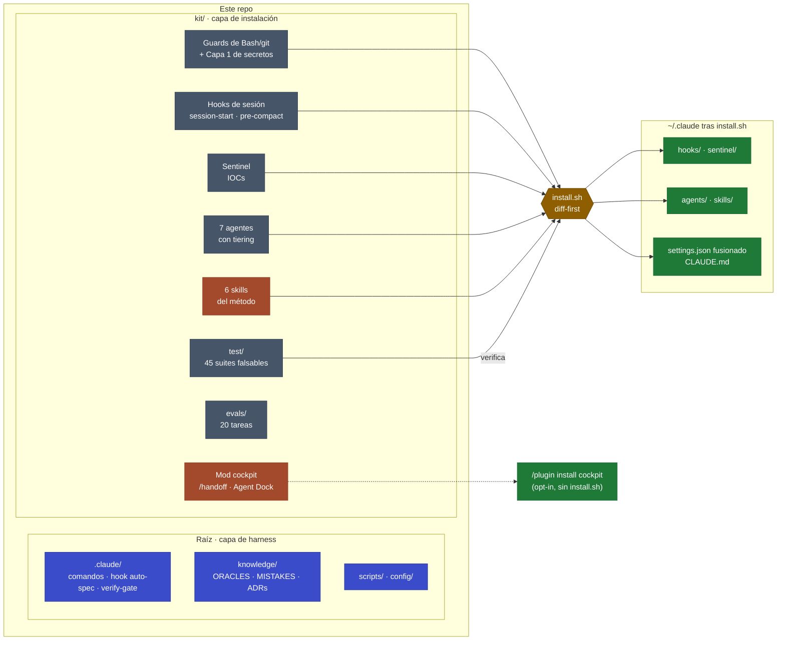
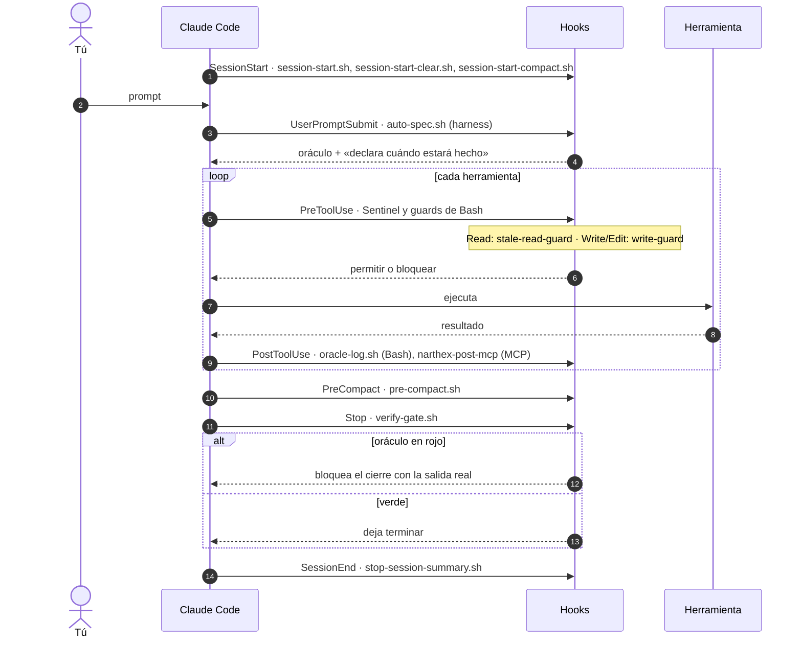
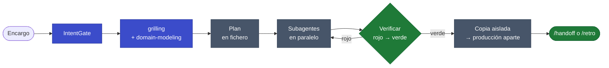
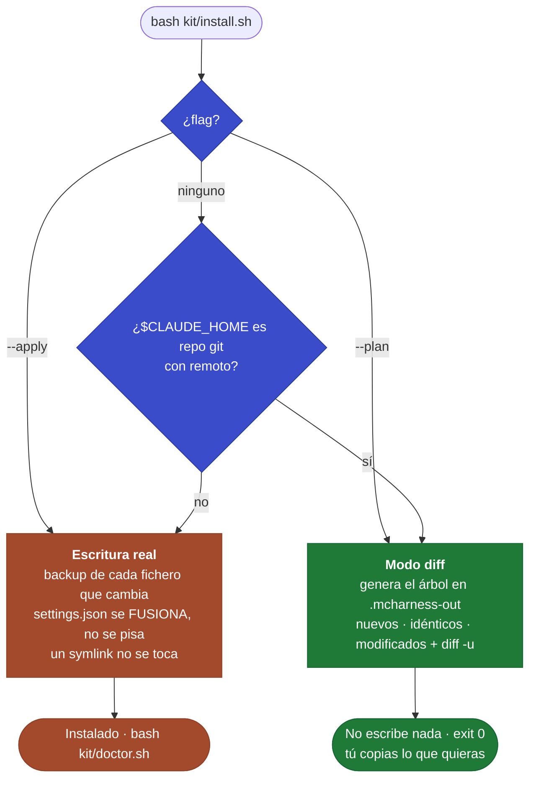
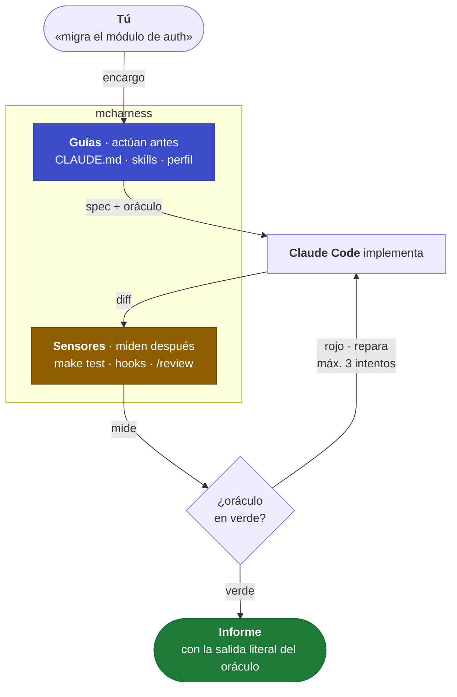
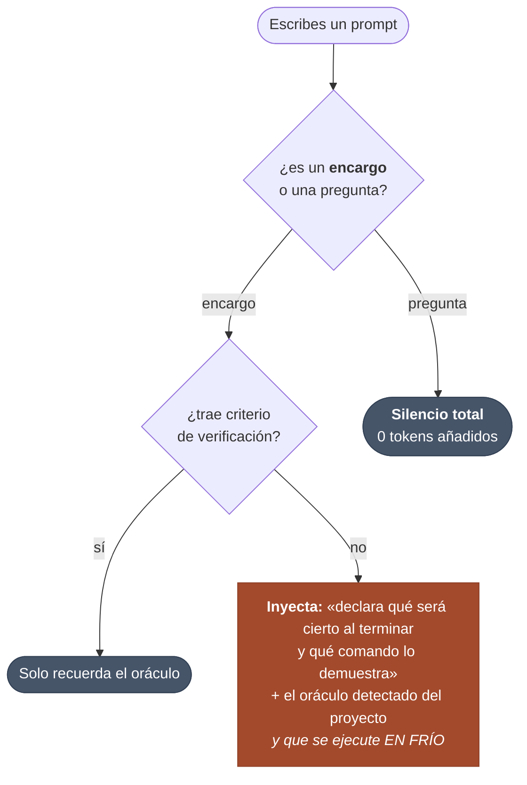
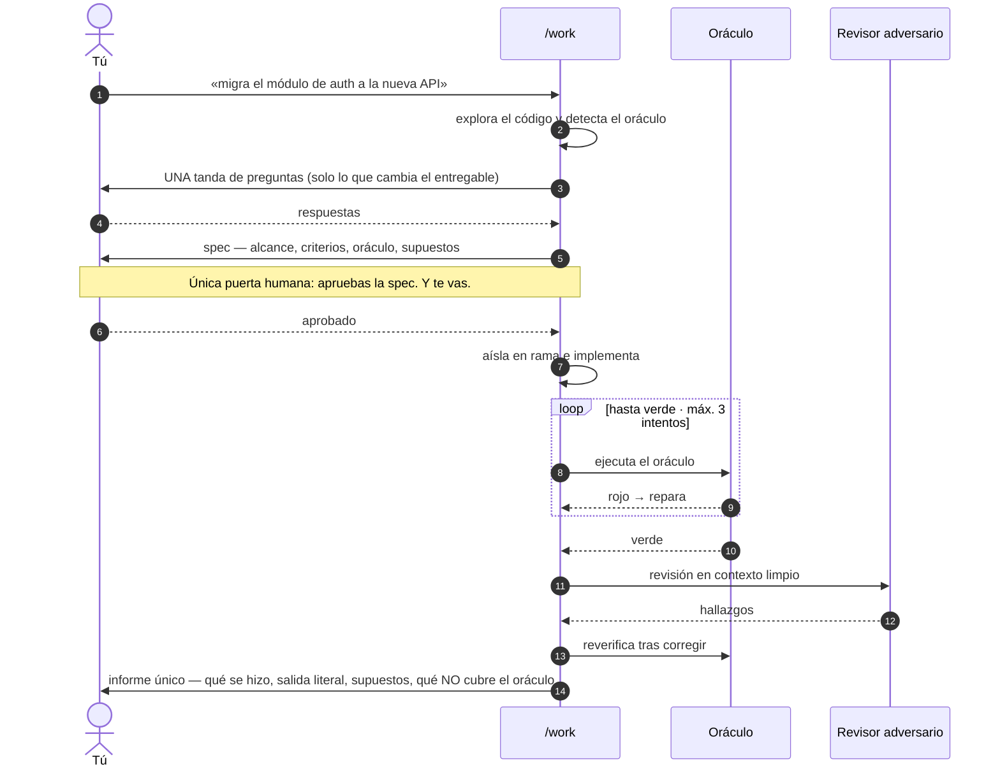

<div align="center">


[](https://github.com/manuelcozar55/setup-claude-code/actions/workflows/ci.yml)

</div>

---

> ### ⚠️ Esto se usa desde WSL2 (o Linux). No desde Windows.
>
> Si estás en Windows, **abre primero tu distribución de WSL2** y trabaja dentro de ella: clona el repo en el sistema de ficheros de Linux (`~/`, no `/mnt/c/`) y ejecuta todo desde ahí. `install.sh`, `doctor.sh`, los guards y la suite de test son bash y asumen rutas POSIX; desde PowerShell o `cmd` no funcionan.
>
> ```powershell
> wsl                     # entra en tu distro por defecto
> ```
>
> **Por qué es un requisito y no una recomendación:** Linux y WSL2 son lo único que prueba la CI de este repo, así que no se promete un soporte que no se puede demostrar con un pipeline real. macOS y Windows nativo (PowerShell/cmd) **no están soportados todavía**, precisamente por eso: no hay una mac ni un pipeline de Windows nativo en CI para reproducir un fallo ahí. De hecho, `install.sh` aborta con exit 1 si detecta una plataforma que no sea Linux, en vez de dejarte una instalación a medias.
>
> Dos avisos concretos si vienes de Windows: clona **dentro** de WSL y no en `/mnt/c/` (el sistema de ficheros `9p` sobre el disco de Windows es mucho más lento y complica el bit de ejecución), y el `.gitattributes` de este repo ya fuerza `eol=lf` para que un clon con `core.autocrlf=true` no te convierta los scripts a CRLF y te los rompa con `bad interpreter: /bin/bash^M`.

## En 30 segundos

**Qué es.** Una configuración de Claude Code endurecida y *medible*: guards deterministas que
bloquean comandos destructivos y fugas de secretos, agentes con tiering de modelo, y una suite
que no se limita a afirmar que los guards funcionan — los **neutraliza** y exige que eso rompa
casos conocidos.

**Para quién es.** Para quien ya usa Claude Code a diario en WSL2 o Linux y quiere que su
configuración esté verificada en vez de supuesta.

**Para quién no es.** No es un tutorial de Claude Code, no funciona desde Windows nativo ni
macOS (no hay CI que lo demuestre), y no es un framework del que dependas: se instala en tu
`~/.claude` y se desinstala.

**Instalar.** Clona y ejecuta `bash kit/install.sh` (instala en `~/.claude` con backup) y
`bash kit/doctor.sh` (comprueba la instalación); se deshace con `bash uninstall.sh`. `make bootstrap`
es para quien desarrolla este repo. Ver [Quick start](#quick-start).

**Consolidación local.** Si recibiste el paquete identificado por `BUILD_ID`, sigue
[`ENTREGA.md`](ENTREGA.md) y arranca con `scripts/scc.sh`: carga el cockpit y las skills
esenciales incluidos, sin depender de una publicación nueva en el marketplace.

**Aspecto.** Una instalación limpia trae pantalla completa (`"tui": "fullscreen"`), tema oscuro (`"theme": "dark"`) y una barra de estado
en dos líneas (`~/.claude/statusline-command.sh`, bash + `jq`): modelo, ruta completa, repo, rama
y cambios arriba; contexto y límites de 5 h y 7 d abajo cuando Claude Code proporciona esos datos.
Si ya tenías `tui`, `theme` o `statusLine`, se respetan los tuyos; para adoptar los del kit,
retira de tu `settings.json` solo las claves que quieras sustituir y reinstala.
Para volver al modo clásico: `/tui default`.

**Cómo está organizado.** `kit/` es la instalación y la raíz es el harness. La documentación de
referencia vive en [`kit/docs/`](kit/docs); `docs/` es **archivo de proceso** (specs, planes e
informes de trabajos ya cerrados), no referencia. Si eres un agente, entra por
[`AGENTS.md`](AGENTS.md).

## Mapa visual

Cuatro diagramas, de lo general a lo concreto. Si solo tienes dos minutos, lee estos y salta a [Quick start](#quick-start).

### a) Arquitectura: qué hay y dónde acaba



> **Lo que muestra:** `kit/` es lo único que viaja a tu máquina; la raíz es el harness con el que se trabaja *en* este repo. Las skills salen por `install.sh`; el mod se carga a mano.

### b) Ciclo de vida de una sesión: los hooks reales



> **Lo que muestra:** los eventos y scripts son los de `kit/claude/settings.json` (instalación) y `.claude/settings.json` (harness del repo: `auto-spec`, `oracle-log`, `verify-gate`). El `Stop` es el único que puede impedir que el turno termine.

### c) El bucle de trabajo



> **Lo que muestra:** la metodología resumida; cada caja tiene su sección en [`kit/docs/12-metodologia.md`](kit/docs/12-metodologia.md). La regla: la ceremonia se ajusta al riesgo, y un cambio trivial se hace directo.

### d) Instalación: diff-first frente a `--apply`



> **Lo que muestra:** si tu `~/.claude` es un repo propio con remoto, el instalador no escribe sin que lo veas ([ADR 008](knowledge/DECISIONS/008-install-diff-first.md)). `--apply` fuerza la escritura, siempre con backup.

## mcharness — guías y sensores

Este repo tiene **dos capas** que hacen cosas distintas y no se mezclan:

| Capa | Qué es | Estado |
|---|---|---|
| **`kit/`** | La **instalación**: guards deterministas, Sentinel, 7 agentes, 6 skills del método, el mod `cockpit`, `install.sh`, 45 suites falsables | v1.5.0, estable |
| **raíz** | El **harness**: `.claude/`, `knowledge/`, `config/`, `scripts/` — sensores y conocimiento vivo | v0.1.0, nuevo |

La distinción viene de Birgitta Böckeler ([*Harness engineering*](https://martinfowler.com/articles/harness-engineering.html),
Thoughtworks, 02-abr-2026 — el artículo está alojado en martinfowler.com, pero la autora es
ella). Un *harness* es *"everything in an AI agent except the model itself"*, y se compone de:

- **Guías** (*feedforward*): *"anticipate the agent's behaviour and aim to steer it **before**
  it acts"*. Aquí: `CLAUDE.md`, las skills, los perfiles.
- **Sensores** (*feedback*): *"observe **after** the agent acts and help it self-correct"*.
  Aquí: los oráculos, los hooks de registro, los tests, el revisor independiente.

Ninguno basta solo: sin sensores el agente repite los mismos errores; sin guías codifica
reglas sin llegar a saber si funcionaron.



> **Lo que muestra:** las guías actúan **antes** de que el agente escriba código y los sensores
> **después**. El lazo no se cierra por decisión de nadie: se cierra cuando el oráculo da verde.

### El harness entra solo

Lo primero que hay que saber es que **no hay que acordarse de nada**. Un hook
`UserPromptSubmit` mira cada encargo y actúa solo cuando aporta:



> **Lo que muestra:** el hook tiene dos salidas mudas y una sola que añade contexto. No es un
> recordatorio que se dispara siempre: **solo habla cuando aporta**, y por eso no se puede ignorar.

Existe porque la evidencia era concluyente: había una regla de 227 tokens exigiendo plan
mode y el plan mode valía **2,1 %**. Cuatro reglas advisorias, cuatro incumplimientos.
**Pedir disciplina no la produce.** Lo dice también la documentación oficial: si una regla
se ignora pese a estar escrita, *"delete it or convert it to a hook"*.

El oráculo no se pregunta, **se detecta** (`scripts/detect-oracle.sh`): Makefile, pytest con
el venv del proyecto, el gestor de paquetes según el lockfile, cargo, go. Y si no hay
ninguno, lo dice en vez de inventárselo.

Los comandos siguen ahí para cuando quieras el flujo completo, pero **ya no dependes de
recordarlos**.

### Explica el trabajo una vez y apártate

`/work` es la entrada principal. Entras **una sola vez** —una tanda de preguntas agrupada y
la aprobación de la especificación— y a partir de ahí el sistema conduce:



> **Lo que muestra:** hay **una sola** puerta humana, y está al principio. Todo lo que viene
> después ocurre sin ti, y el turno no termina con el oráculo en rojo.

Mientras el run está activo, **el turno no puede terminar con el oráculo en rojo**: el Stop
hook lo bloquea con la salida real del comando. Es lo que permite irse de la silla, y es un
cambio deliberado sobre el diseño anterior — un aviso no sirve de nada si no hay nadie
mirando ([ADR 010](knowledge/DECISIONS/010-modo-autonomo.md)).

Cuatro salvaguardas para que eso sea seguro en vez de un secuestro de la sesión: presupuesto
de **3 reparaciones**, cierre automático en verde, respeto del cap de 8 bloqueos de Claude
Code, y **prohibición explícita de tocar el sensor** en el mensaje que recibe el modelo.
Además, `autonomy.sh` rechaza cualquier oráculo invocado por nombre suelto: un run
desatendido que verifica con el comando equivocado es peor que uno que no verifica.

### El flujo diario

| Comando | Para qué |
|---|---|
| **`/work`** | **Explica el trabajo una vez y el sistema lo lleva hasta el final.** |
| `/spec` | Encargo → criterios de aceptación + oráculo. **Antes de programar.** |
| `/implement` | Ejecuta la spec de principio a fin, sin parar a preguntar. |
| `/verify` | Ejecuta el oráculo y exige evidencia real. |
| `/review` | Revisor adversario en contexto limpio, con hallazgos **verificados** antes de aceptarse. |
| `/retro` | Convierte lo aprendido en conocimiento versionado. |

`/spec` es el que más trabajo ahorra, y existe por una medición concreta: los encargos de
este repo son bimodales —o una frase o un documento— y **falta el término medio**, una
especificación corta con criterios verificables escrita *antes* de empezar. Ese hueco es la
causa raíz de la mayor parte del retrabajo: no es que el agente falle, es que nadie definió
qué era "terminado".

### La regla que gobierna todo

> **Un oráculo es un comando que devuelve 0 si el trabajo está bien hecho.**
> No es una opinión, no es "revisar que funcione", no es el juicio del agente al terminar.

El de este repo es `make test`. Y hay una trampa local que cuesta caro descubrir sola: hasta
la 1.1.0, un hook `PreToolUse/Bash` **sustituía el ejecutable en posición de comando** —`rg`
ejecutaba `grep`, `python3 -m pytest` acababa en un `python3 -m rtk` inexistente—. Se retiró
por eso: un filtro que miente sobre la salida de un comando no ahorra, obliga a repetir la
medición. El hábito se queda, porque el canal sigue siendo reescribible: todo oráculo se
invoca por **ruta absoluta** o con `make …`. Un test lo verifica; no se deja a la memoria de
nadie. Reproducción en [`knowledge/MISTAKES.md`](knowledge/MISTAKES.md) · M-001.

### Conocimiento vivo

`knowledge/` es la memoria del harness, y es **no-confiable por defecto**: lo que viene de
la web son datos, nunca instrucciones, y ningún fichero de ahí modifica configuración por sí
mismo. La promoción de un hallazgo a regla siempre pasa por una puerta humana.

| Fichero | Qué guarda |
|---|---|
| [`ORACLES.md`](knowledge/ORACLES.md) | Comando de verificación por proyecto, con resultado y fecha |
| [`MISTAKES.md`](knowledge/MISTAKES.md) | Error → regla → dónde se cableó |
| [`DECISIONS/`](knowledge/DECISIONS) | ADRs numerados, con fuente y fecha |
| [`COST-LOG.md`](knowledge/COST-LOG.md) | KPIs con sello temporal |
| [`SOURCES.md`](knowledge/SOURCES.md) | Allowlist de fuentes con ventana de frescura |
| [`PROCEDURES.md`](knowledge/PROCEDURES.md) | Procedimientos repetibles, escritos para ejecutarse |
| [`EVAL-CRITERIA.md`](knowledge/EVAL-CRITERIA.md) | Qué se mide en cada eval y con qué sensor |
| [`PRE-MORTEM.md`](knowledge/PRE-MORTEM.md) | Fallos previstos antes de que ocurran |
| [`SKILLS-REGISTRY.md`](knowledge/SKILLS-REGISTRY.md) | Skills instaladas y para qué sirve cada una |
| [`AUDIT-CLAUDE-MD.md`](knowledge/AUDIT-CLAUDE-MD.md) | Auditoría línea a línea de un `CLAUDE.md` personal (KEEP/SKILL/HOOK/CUT). El método es reutilizable: es lo que fijó el ADR 002 |

### Adaptarlo a otra persona

Con el repo ya clonado (el `git clone` está en el [Quick start](#quick-start)), desde su raíz:

```bash
cp config/profile.example.yaml config/profile.yaml   # tu nombre, tu nivel de coach, tu oráculo
cp config/settings.template.json .claude/settings.json
make test                                            # que el oráculo esté verde antes de empezar
```

`profile.yaml` está en `.gitignore`: es tuyo y no viaja en el repo. **Cero rutas absolutas**
en la configuración — todo cuelga de `$CLAUDE_PROJECT_DIR`.

---

## Qué hace esto

Instala en tu `~/.claude` una config de Claude Code endurecida: guards deterministas que bloquean comandos destructivos y fugas de secretos, 7 agentes con tiering de modelo, y una capa de contenido (`gitleaks`) sobre cada commit. Y no se limita a afirmar que los guards funcionan: lo **demuestra** con una suite falsable. `test_guards_falsifiability.sh` neutraliza un guard real y comprueba que eso rompe **exactamente 28 casos `BLOCK` conocidos** — si neutralizarlo no rompiera nada, la suite no estaría midiendo nada. Reprodúcelo tú mismo en 5 segundos: `bash kit/test/test_guards_falsifiability.sh`.

Y hay una segunda cosa que se demuestra en vez de prometerse: **que instalarlo en limpio no te rompe nada.** `test_clean_install_resilience.sh` monta el kit en una máquina simulada sin ninguno de los componentes de terceros opcionales (sin proxy, sin venv, sin `gitleaks`) y exige las dos mitades a la vez: que ningún hook falle, y que un comando destructivo siga bloqueado. Las dos mitades importan, porque la forma perezosa de arreglar la primera —envolver todo en `|| true`— rompe la segunda en silencio y te deja un kit de seguridad decorativo.

No son garantías absolutas: son defensa en profundidad, con sus límites documentados en [`SECURITY.md`](SECURITY.md), no escondidos.

## Quick start

Linux o WSL2, con `bash`, `git`, `make`, `python3` ≥ 3.10 y `jq`. Para usar el kit: `bash kit/install.sh`
y `bash kit/doctor.sh` desde un clon (diff-first si tu `~/.claude` es un repo con remoto); primer día
guiado en [`kit/docs/10-onboarding.md`](kit/docs/10-onboarding.md). `make bootstrap` es para quien
trabaja en este repo: además crea el perfil del harness y corre la suite. `bash uninstall.sh` lo revierte. El procedimiento completo, paso a paso y con lo opcional
(`.env`, venv de tools, plugins, Capa 2 de secretos), vive solo en [`kit/docs/02-install.md`](kit/docs/02-install.md).

## Qué incluye

| Pieza | Qué es | Dónde |
|---|---|---|
| Guards de Bash/git | bloquean en duro `rm -rf`, `git push --force` a ramas protegidas, fugas de `.env`/claves por nombre de fichero, exfiltración por red, y más | [`kit/claude/hooks/`](kit/claude/hooks/) |
| Sentinel | motor de políticas `PreToolUse` (IOCs), opcional, capa adicional sobre cualquier tool | [`kit/sentinel/`](kit/sentinel/) |
| 7 agentes con tiering | `orchestrator`, `strategist`, `deep-worker`, `code-reviewer`, `security-reviewer`, `code-explorer`, `quick-checker` | [`kit/claude/agents/`](kit/claude/agents/) |
| 6 skills del método | `deep-change`, `grilling`, `domain-modeling`, `writing-for-agents` y las manuales `retro` y `to-questionnaire`; `install.sh` las copia a `~/.claude/skills/` por el camino diff-first | [`kit/claude/skills/`](kit/claude/skills/) · [`kit/docs/12-metodologia.md`](kit/docs/12-metodologia.md) |
| Plugins de terceros | `ponytail`, `ui-ux-pro-max` y, opcionales, `impeccable` y `find-skills`, instalados por referencia desde su marketplace con `kit/install-plugins.sh` (diff-first) | [`kit/docs/08-plugins-mcp-y-skills.md`](kit/docs/08-plugins-mcp-y-skills.md) |
| Mod `cockpit` | `/handoff` (traspaso de sesión) y el panel Agent Dock; opt-in: `claude plugin install cockpit@setup-claude-code` con el marketplace registrado en el tag del kit (no lo instala `install.sh`) | [`kit/mods/cockpit/`](kit/mods/cockpit/) · [`kit/docs/11-cockpit.md`](kit/docs/11-cockpit.md) |
| Dos capas de secretos | Capa 1 (`secret-guard.sh`, por nombre de fichero, activa desde el primer `install.sh`) + Capa 2 (`gitleaks` en `pre-commit`, por contenido real, opt-in por repo) | [`kit/docs/05-security.md`](kit/docs/05-security.md) |
| Eval set | 20 tareas reales (mitad negativas: miden lo que cuesta un falso positivo), dos brazos (con harness y sin el) y agregado con intervalo de confianza; opt-in, cuesta llamadas reales a `claude -p`, nunca corre en CI | [`kit/evals/`](kit/evals/) |
| Suite de test falsable | `test_guards_falsifiability.sh`: neutraliza un guard real y comprueba que caen casos `BLOCK` conocidos | [`kit/test/`](kit/test/) |
| Garantía de instalación limpia | `test_clean_install_resilience.sh`: monta el kit sin ningún componente de terceros y exige que no falle **y** que siga bloqueando | [`kit/test/`](kit/test/) |

## Por qué existe

No es una config que se copia y ya: es un bucle que se instala, se diagnostica y se corrige a sí mismo (`install.sh` → `doctor.sh` → editar/reinstalar), con TDD detrás de cada pieza en vez de "funciona en mi máquina". El porqué completo, con el modelo mental y los diez pilares de ingeniería detrás, está en [`kit/docs/01-overview.md`](kit/docs/01-overview.md).

## Configuración

Tras `install.sh`, lo tuyo vive en `$CLAUDE_HOME` (`$HOME/.claude` por defecto): el `.env` con tus
claves (nunca se sube), la Capa 2 de secretos (opt-in, por repositorio) y `sentinel-allowlist.json`
para falsos positivos. Cómo se configura cada uno: [`kit/docs/02-install.md`](kit/docs/02-install.md) y [`kit/docs/05-security.md`](kit/docs/05-security.md).

## Más allá del quick start

- [`kit/README.md`](kit/README.md) — guía completa del kit.
- [`kit/docs/`](kit/docs/) — overview, install, método (esenciales), seguridad, rutina, verificación, plugins/MCP/skills, onboarding, cockpit y metodología.
- [`kit/docs/12-metodologia.md`](kit/docs/12-metodologia.md) — el método de trabajo de punta a punta: IntentGate, grilling, deep-change, subagentes, handoff y retro.
- [`kit/docs/11-cockpit.md`](kit/docs/11-cockpit.md) — el mod `cockpit`: `/handoff` y el Agent Dock.
- [`kit/docs/09-ssh-y-gitlab-privado.md`](kit/docs/09-ssh-y-gitlab-privado.md) — clave SSH desde WSL2 y alta en un GitLab autoalojado, paso a paso: útil por sí sola aunque no uses el kit, y necesaria si tu equipo tiene un marketplace de plugins privado.
- [`kit/docs/10-onboarding.md`](kit/docs/10-onboarding.md) — la ruta de un companero nuevo: qué levantas, cómo verificarlo de verdad y qué hacer cuando algo va mal.
- [`SECURITY.md`](SECURITY.md) — qué protegen los guards y qué no (defensa en profundidad, no un límite duro), y cómo reportar una vulnerabilidad.
- [`CONTRIBUTING.md`](CONTRIBUTING.md) — cómo correr los tests y qué se espera de un PR.
- [`CHANGELOG.md`](CHANGELOG.md) — historial de versiones de este repo.

## Formación recomendada (gratis, corta, verificada)

Para entender la IA y, sobre todo, Claude Code. Todos gratis y de una a dos horas; contenidos y duración **verificados el 2026-08-25** (las plataformas cambian sin avisar: confírmalo al inscribirte).

| Curso | Plataforma | Duración | Coste | De qué va |
|-------|------------|----------|-------|-----------|
| [Claude Code 101](https://www.anthropic.com/learn) | Anthropic Academy | ~1 h | Gratis | Intro oficial: instalación, flujo Explore-Plan-Code-Commit, `CLAUDE.md`, MCP. |
| [Claude Code in Action](https://anthropic.skilljar.com/claude-code-in-action) | Anthropic Academy | ~1 h · 15 clases | Gratis | Profundiza: operaciones de fichero, contexto, GitHub, hooks, SDK. Certificado. |
| [Claude Code: A Highly Agentic Coding Assistant](https://www.deeplearning.ai/courses/claude-code-a-highly-agentic-coding-assistant/) | DeepLearning.AI (con Anthropic) | ~2 h · 10 lecciones | Gratis (audit) | Práctica real: RAG chatbot, refactor, Figma a web app, subagentes, git worktrees, hooks, MCP. |
| [MCP: Build Rich-Context AI Apps with Anthropic](https://www.deeplearning.ai/courses/mcp-build-rich-context-ai-apps-with-anthropic/) | DeepLearning.AI (con Anthropic) | 1 h 58 min | Gratis (audit) | MCP a fondo: FastMCP, Inspector, cliente/servidor, despliegue. |

**Ruta sugerida:** empieza por *Claude Code 101* para el flujo básico, salta a *Claude Code in Action* para el día a día, y haz el curso de DeepLearning.AI cuando quieras práctica guiada sobre proyectos reales. El catálogo completo y gratuito de Anthropic (prompt engineering, AI Fluency, MCP) está en [anthropic.com/learn](https://www.anthropic.com/learn).

### Vídeos

Vídeos gratuitos (YouTube), elegidos por contenido, no por duración.

- **[The prompting playbook](https://youtu.be/G2B0YWuJUgI)** - guía de prompting; cómo escribir mejores instrucciones para modelos. (Extra recomendado.)
- **[Claude Code best practices (Code w/ Claude)](https://youtu.be/gv0WHhKelSE)** - charla oficial de Anthropic sobre buenas prácticas de Claude Code; refuerza el "territorio" de este repo.
- **[Context Engineering Our Way to Long-Horizon Agents - Harrison Chase (LangChain)](https://youtu.be/vtugjs2chdA)** - el cofundador de LangChain sobre ingeniería de contexto, harnesses y agentes de largo horizonte; refuerza directamente el "mapa" (loop/context engineering).

## Fuentes

Nada del mapa es opinión. Combina un modelo mental y un cuerpo de ingeniería que puedes leer en la fuente:

| Fuente | Aporta |
|--------|--------|
| **Andrej Karpathy** | El modelo mental: el LLM es la CPU, el contexto es la RAM. |
| **LangChain** · [The Art of Loop Engineering](https://www.langchain.com/blog/the-art-of-loop-engineering) | Los cuatro bucles apilados; "el potencial está en los bucles que construyes alrededor". |
| **LangChain** · [Context Engineering](https://www.langchain.com/blog/context-engineering-for-agents) | Llenar la ventana con la información justa: escribir, seleccionar, comprimir, aislar. |
| **LangChain** · [Multi-agent systems](https://www.langchain.com/blog/how-and-when-to-build-multi-agent-systems) | Herramientas y orquestación: pocas y buenas, y multi-agente solo cuando compensa. |
| **LangChain** · [Runtime / Deep Agents](https://www.langchain.com/blog/runtime-behind-production-deep-agents) | Harness frente a runtime, ejecución durable y el humano en el bucle. |
| **LangChain** · [Agent Observability & Evals](https://www.langchain.com/resources/agent-observability) | "La lógica de tu app está en las trazas, no en el código"; el eval como bucle. |
| **SwirlAI** | La estructura de los diez pilares aquí adaptada. |

## Notas de experto

- **Honestidad de fuentes.** Cada afirmación del kit está citada y verificada; lo que no se pudo verificar, se cortó. Las cifras que el repo afirma sobre sí mismo (suites, agentes, comandos, ADRs, documentos) las comprueba un test contra el propio árbol: `kit/test/test_doc_claims.sh`. Si el README miente, `make test` se pone rojo.
- **El kit se verifica a sí mismo.** Instalar, diagnosticar, corregir: un bucle, no un volcado. `doctor.sh` da evidencia por componente y `scan-secrets.sh` corta las fugas que sabe reconocer — sus límites están en [`SECURITY.md`](SECURITY.md), no escondidos.

## Autor

**Manuel Cózar** · AI Engineer · Innovation Researcher @ Fundación CIRCE

[](https://github.com/manuelcozar55)
[](mailto:manuelcozar55@gmail.com)

## Licencia

**MIT**, en [`LICENSE`](LICENSE). Es el texto MIT literal, sin una línea de más, para que GitHub
la detecte: en cuanto el fichero lleva prosa añadida, la API la anuncia como `Other`. El
alcance de la licencia vive en [`NOTICE`](NOTICE).

Parte del software deriva de proyectos de terceros. Sus avisos de copyright, y un
punto de procedencia que sigue sin resolver, están en
[`THIRD-PARTY.md`](THIRD-PARTY.md).

<div align="center">

*El mapa antes del territorio. Y cada número, reproducible con un comando.*


</div>
