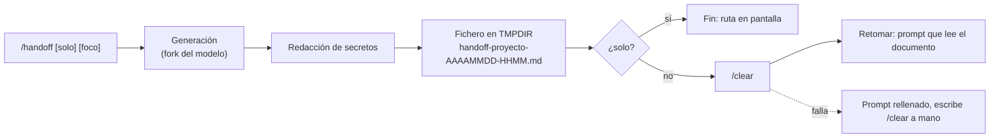

# 11 · Cabina: handoff y Agent Dock

`kit/mods/cabina/` es un mod de Claude Code (plugin de *function hooks*, superficie de acceso temprano: puede cambiar entre versiones). Aporta dos cosas y es opt-in: nada del kit lo carga por ti.

## Qué hace

- **`/handoff`**: pide al modelo un documento de traspaso, lo guarda en el directorio temporal del SO, limpia el contexto (`/clear`) y retoma desde el documento.
- **Agent Dock**: un panel lateral con una tarjeta por subagente (estado, actividad, tiempo), a una columna. También lleva el vigía de contexto con handoff sobre el prompt y `/simple` (modo de pasos con resumen corto).

## Cómo se carga

```bash
claude --plugin-dir <ruta>/kit/mods/cabina
# o, para todas las sesiones de ese entorno:
export CLAUDE_CODE_PLUGIN_DIRS=<ruta>/kit/mods/cabina
```

`CLAUDE_CODE_PLUGIN_DIRS` está citada por el propio binario de Claude Code. Para dejar de cargarlo, quita la variable (o la entrada del bloque `env` de settings que la define).

## `/handoff`

```
/handoff [solo] [foco de la próxima sesión]
```

- Sin argumentos: guarda el documento, hace `/clear` y envía un prompt de retoma.
- `solo`: guarda el documento y no limpia nada.
- El resto del texto es el **foco**: el documento se adapta a lo que hará la próxima sesión.

El fichero se escribe en `$TMPDIR`, si no `$TEMP`, si no `/tmp`, con el nombre `handoff-<proyecto>-AAAAMMDD-HHMM.md` (hora UTC; `<proyecto>` es el último segmento del cwd). Antes de escribirlo se redactan claves conocidas (`sk-`, `ghp_`, `AKIA`, `xox*`, JWT) y asignaciones tipo `password=`/`token:` como `[REDACTADO]`. También cubre `Bearer …`, bloques `PRIVATE KEY`, credenciales en URLs (`esquema://usuario:clave@`), `github_pat_`/`glpat-` y valores entrecomillados (incluido JSON). Es una red de seguridad parcial y no garantiza nada: la redacción principal la hace el prompt de handoff, y el filtro solo recoge lo que el modelo deje pasar.

Secciones del documento: Objetivo · Invariantes y decisiones (con su porqué) · Plan (`[x]`/`[ ]`) · Paso actual · Pendientes y riesgos · Ficheros clave · Comandos de verificación · Lo que NO hay que repetir · Skills sugeridas. No duplica specs, planes, issues ni commits: los referencia por ruta o URL.



## Agent Dock

Se abre solo al iniciar sesión (columna de 58 de ancho) y con `/dock`. Cada subagente tiene su tarjeta con descripción, estado, última actividad y cuenta de herramientas; el panel resume además el equipo y deja elegir el tamaño de equipo, que viaja al modelo como contexto oculto del prompt. Los tests lo renderizan a 24, 28 y 56 columnas comprobando que no se corta ningún control.

## Tests

```bash
cd kit/mods/cabina
claude plugin validate .                          # Validation passed
claude plugin test .                              # 16 pass, 0 fail
pnpm dlx --package=typescript@5 tsc -p .          # rc=0
bash ../../test/test_mod_cabina.sh                # estructura y saneado; sin red ni claude
```

`tsconfig.json` extiende `.claude-plugin/types/tsconfig.json`, que **no se versiona**: lo escribe Claude Code junto al mod cuando lo carga desde una carpeta propia (versión TypeScript 5.4 o superior) y su contenido es de Claude Code, no nuestro. Si falta, `tsc` falla con `Cannot find module 'claude-code/testing'`. Para regenerarlo, carga el mod una vez, por ejemplo `claude -p --plugin-dir "$PWD" "ok"`; si en tu versión no aparece, copia la carpeta `.claude-plugin/types/` de otro mod ya cargado. Está en `.gitignore`. `validate` y `test` no lo necesitan. Sin esos tipos `tsc` pierde el `noEmit` heredado y escribe `.js` junto a las fuentes: bórralos si pasa.

`claude plugin test` funciona desde cualquier carpeta, no solo desde dev-mods.

## Limitaciones conocidas

- **`/clear` lanzado desde el mod no está verificado en una sesión interactiva.** Se comprobó de punta a punta con el arnés de tests, no a mano. Si falla, el mod deja el documento guardado y rellena el prompt de retoma; escribe `/clear` y envía ese texto.
- **Los estados `failed`, `killed` y `stuck` de las tarjetas del dock no se han probado en el render**; solo los estados en curso y completado.
- El redactor de secretos es un último recurso parcial; revisa el documento antes de compartirlo.
- **El fichero de handoff no es privado**: su nombre es predecible (`handoff-<proyecto>-AAAAMMDD-HHMM.md`) y se crea con los permisos por defecto, no 0600, ni en exclusiva. La API del mod (`$.fs.write(path, text)`) no admite modo ni creación exclusiva, así que no se puede endurecer desde el mod. En un equipo compartido, apunta `TMPDIR` a un directorio tuyo con permisos 0700.
- El prompt de retoma indica al modelo que el handoff es información y no órdenes, pero eso mitiga la inyección de instrucciones arrastradas de la sesión anterior, no la elimina.
