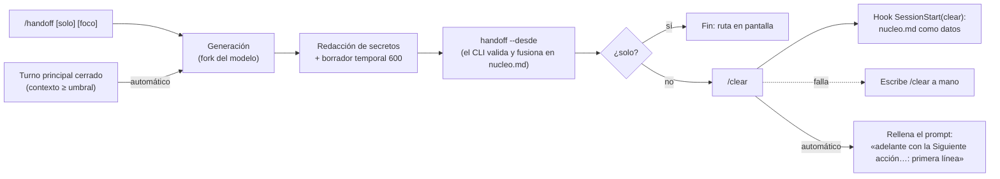

# 11 · Cockpit: handoff y Agent Dock

`kit/mods/cockpit/` es un mod de Claude Code (plugin de *function hooks*, superficie de acceso temprano: puede cambiar entre versiones). Aporta dos cosas y es opt-in: `install.sh` no lo carga.

## Qué hace

- **`/handoff`**: pide al modelo el borrador de las secciones del estado y se lo entrega al CLI `~/.claude/bin/handoff`, que lo valida y lo fusiona en `.claude/estado/nucleo.md`; después limpia el contexto (`/clear`) y la sesión nueva lo recibe del hook `SessionStart`.
- **Sin cockpit**: `install.sh` no lo instala. El defecto del kit es checkpoint + reinyección + aviso: el checkpoint de `pre-compact.sh`, `nucleo.md` reinyectado tras compactar y un aviso al modelo si lleva más de 10 min sin actualizarse (`handoff --desde <borrador>`, con la ruta `~/.claude/bin/handoff` si no está en el `PATH`). `/handoff` es manual; el cockpit es la opción automática.
- **Handoff automático**: al cerrar un turno con el contexto al 70 % del límite de autocompactación, el mod guarda el estado con el mismo handoff, hace `/clear` y deja escrito en el prompt «adelante con la Siguiente acción…: <su primera línea>».
- **`/nueva <tarea>`**: cambia de tarea. Archiva el `nucleo.md` actual, limpia el contexto y deja la tarea nueva en el prompt.
- **`/autonomo on|off`**: continuación automática del trabajo ya autorizado tras un handoff confirmado. Está apagada por defecto y `/nueva` la desactiva.
- **Agent Dock**: un panel lateral con la misión en curso y los subagentes en cuatro secciones fijas (trabajando, en cola, parados, hechos). Muestra también el dueño del estado y el % del tope del `nucleo.md`. Lleva además el vigía de contexto con handoff sobre el prompt y `/simple` (modo de pasos con resumen corto).

## Cómo se carga

La versión 1.6.1 del kit incluye cockpit 0.6.2.
`scripts/scc.sh` carga la copia de tu checkout mediante `--plugin-dir`, sin instalar
nada; las órdenes de marketplace de abajo instalan esa misma versión desde el tag
publicado, para todas tus sesiones. En un paquete transferido, `VERSION` identifica
la publicación, y `BUILD_ID` con el manifiesto SHA-256 identifican el contenido.

**Versión de Claude Code.** El mod se probó con Claude Code 2.1.292 (`claude --version`). No se ha comprobado una versión mínima: los mods son de acceso temprano y pueden cambiar entre versiones. Comprueba la tuya antes de instalar y, si algo no carga, `claude plugin validate kit/mods/cockpit` dice qué falla.

**El `ref` es una etiqueta, no un sha.** La fuente `github` de un marketplace admite `ref` pero no `sha` (solo las fuentes de cada plugin lo admiten), y una etiqueta de git se puede mover. Protege las etiquetas `v*` en el remoto si quieres un pin real.

**Va con la versión del kit.** El marketplace del kit queda fijado al tag de tu versión (`extraKnownMarketplaces` en `settings.json`), y `install.sh` mueve ese ref en cada actualización. Sin el ref, el cockpit seguía a `main` y podía adelantarse a `~/.claude/bin/handoff`: `/handoff` fallaba con «falta …/bin/handoff». Tras pasar el kit a otra versión (ver «Actualizar» en [`02-install.md`](02-install.md)), repite las dos órdenes de abajo y ejecuta `claude plugin update cockpit@setup-claude-code`.

Este repo es un marketplace (`.claude-plugin/marketplace.json`). Para todas tus sesiones, en scope user, desde la raíz de tu copia del repo:

```bash
claude plugin marketplace add "manuelcozar55/setup-claude-code@v$(cat VERSION)"
claude plugin install cockpit@setup-claude-code
```

(también lo hace `kit/install-plugins.sh --apply`). Sin el `@v…`, `marketplace add` falla en cuanto `install.sh` ha fijado el marketplace: «its source doesn't match its extraKnownMarketplaces entry». Se actualiza con `claude plugin update cockpit@setup-claude-code` y se quita con `claude plugin uninstall cockpit@setup-claude-code`.

Para desarrollarlo desde una copia de trabajo, sin instalar:

```bash
claude --plugin-dir <ruta>/kit/mods/cockpit
```

## `/handoff`

```
/handoff [solo] [foco de la próxima sesión]
```

- Sin argumentos: guarda el documento y hace `/clear`. El hook `session-start-clear.sh` entrega el estado como datos. En un proyecto añade hechos calculados desde Git; en HOME usa la ranura de este proceso y, si aún no existe, muestra el índice de tareas. Por defecto, el cockpit deja la continuación escrita para revisarla y pulsar Enter. Con `/autonomo on` puede enviarla después de verificar el cambio de sesión y la ausencia de actividad nueva. El estado conserva el encargo; no crea permisos.
- `solo`: guarda el documento y no limpia nada. No confundir con el CLI: `/handoff solo` es el argumento del mod (guarda sin `/clear`), mientras que `handoff --solo` es una opción del CLI y significa otra cosa: el borrador sustituye al `nucleo.md` entero en vez de fusionarse.
- El resto del texto es el **foco**: el documento se adapta a lo que hará la próxima sesión.
- En la banda sobre el prompt, el botón `handoff` (`h`) pide confirmación con tres acciones: `[guardar + /clear]`, `[solo guardar]` y `[no guardar + /clear]` (limpia el contexto sin escribir handoff), dibujadas sin cromo y sin tecla propia: un clic o Enter bajo el foco. Para cancelar, vuelve a pulsar `handoff`. Durante un turno en marcha solo queda `solo guardar`.

El documento es `.claude/estado/nucleo.md` de la raíz del proyecto, la convención de estado que ya leen CLAUDE.md, los hooks PreCompact y la re-inyección tras compactar. **La raíz es** la raíz git del cwd de la sesión, salvo que sea `$HOME` o cuelgue de `$HOME/.claude`; sin git tampoco hay proyecto. Sin proyecto, en `$HOME` el estado es el de esta sesión, en `~/.claude/estado/sesiones/<fecha>-<pid>/` (clave: el proceso de Claude; el CLI la resuelve y el mod solo la usa); fuera de `$HOME` y sin git el mod no hace fork ni escribe nada y lo dice.

**Reparto de trabajo.** El fork del modelo solo redacta un borrador con las secciones de la plantilla (`kit/claude/templates/nucleo.md`): Plan, Paso actual, Siguiente acción, Pendientes, Comandos de verificación y Ficheros tocados, y Objetivo e Invariantes cuando faltan o están vacíos. Pide además tres campos baratos: las correcciones literales de la persona (hasta 3 líneas, con fecha, en Invariantes), los ficheros calientes con rango (`ruta:L120-180 — qué`) y el resultado de cada comando de verificación (`→ rc=N`, que el CLI pliega desde `verificaciones.log`). El mod no fusiona nada: no queda en TypeScript ninguna función de fusión, rotación de copias ni exclusión de git; lo hace `handoff` (`test_mod_cockpit.sh` lo comprueba).

**Cómo se entrega.** Antes de escribir se redactan claves conocidas (`sk-`, `ghp_`, `AKIA`, `xox*`, JWT), asignaciones tipo `password=`/`token:`, `Bearer …`, bloques `PRIVATE KEY`, credenciales en URLs, `github_pat_`/`glpat-` y valores entrecomillados: una red de seguridad parcial, porque la redacción principal la hace el prompt. El borrador va a un fichero temporal propio (`mktemp`, permisos 600, borrado siempre al terminar, también si el CLI falla) y el mod ejecuta, con la ruta absoluta (no depende del PATH):

```
$HOME/.claude/bin/handoff --desde <borrador> --raiz <raíz> --sesion <id> --json
```

Si el binario no existe el mod avisa con la orden de instalación (`bash kit/install.sh`, que copia `handoff` y `oraculo` en `~/.claude/bin`) y no hay fusión de reserva en TypeScript.

Con `CLAUDE_HOME` absoluto usa su `bin/handoff`. En HOME omite `--raiz` y usa la ranura del proceso que devuelve `--estado`; nunca inventa una ruta relativa. El recibo JSON debe confirmar ruta absoluta y SHA-256. Un aviso en stderr, un recibo inválido o un dueño ajeno conservan el contexto. El código 5 indica dueño ajeno y no se reintenta.

Antes de escribir, el fork recibe un presupuesto en bytes UTF-8: del tope que da `handoff --estado` (6500 B menos los 800 que se reservan para el bloque de agentes de la inyección) se reservan las secciones fijas existentes y 768 B para cabecera, separadores y verificaciones del CLI. Se solicita un resumen de hasta 3000 B o el espacio restante si es menor, referenciando la especificación en vez de repetirla. Se mide el borrador redactado con `TextEncoder`; si excede el presupuesto, se permite una sola regeneración compacta. Un segundo exceso conserva contexto y fichero anterior sin invocar el guardado. Nunca se trunca el objetivo literal para hacerlo caber. El CLI sigue siendo la autoridad de fusión y límite final: cualquier aviso suyo impide el clear.

| Exit | Significado | Qué dice la UI |
|---|---|---|
| 0 | Fusionado | «Guardado en …/nucleo.md» y, salvo `solo`, `/clear` |
| 2 | Borrador inválido | «borrador inválido: <cabecera que nombra el CLI>; repite /handoff» |
| 3 | Sin proyecto | «aquí no hay proyecto …: no hay estado que guardar» |
| 4 | `nucleo.md` cambió durante la fusión | Reintenta una vez con el mismo borrador; si vuelve a fallar, «cambió durante la fusión (dos intentos); repite /handoff» |
| 5 | El estado tiene otro dueño | Conserva el contexto y pide resolver la propiedad; no reintenta |

Si la respuesta del fork no trae ninguna sección `## ` no se escribe nada. Si `.claude/estado/`, `nucleo.md` o una copia `nucleo.prev-*` son enlaces simbólicos, el handoff se niega a leer y escribir. Copias, límite de tamaño, `diario.md`, exclusión de `.git/info/exclude` y dueño son del CLI.

Secciones fijas (las fija el CLI: se escriben una sola vez): Objetivo · Invariantes. Secciones que actualiza cada handoff: Plan (`[x]` con el comando que lo verificó, que el CLI mueve a `diario.md` / `[ ]`) · Paso actual · Siguiente acción · Pendientes (incluye riesgos; las líneas que solo puede hacer la persona empiezan por `(persona)` y el índice de `~` las reúne) · Comandos de verificación · Ficheros tocados (los de fuera de git con su copia de seguridad; `handoff --desde` genera arriba un bloque desde git: lo cambiado desde el handoff anterior, marcado con `<!-- git:SHA -->`, más el árbol de trabajo, sin `.claude/estado` (solo nombres de `git status`: un `.env` aparece únicamente si **no** está en `.gitignore`, y entonces es un aviso útil, no una fuga del contenido); debajo se conserva lo escrito a mano). No duplica specs, planes, issues ni commits: los referencia por ruta o URL.



## Handoff automático

Se activa solo, sin comando.

**Disparo.** Al cerrar un turno del bucle principal (`reason` `answer`) con el contexto en o por encima del umbral, un porcentaje del límite de autocompactación. El mod:

1. Guarda el estado con el mismo handoff que `/handoff`.
2. Hace `/clear` desde `$.clock.after`: dentro del hook que el turno espera, el motor lo rechaza.
3. Deja «adelante con la Siguiente acción de .claude/estado/nucleo.md: <primera línea de «Siguiente acción»>» en el prompt, sin enviarlo: así aprobarás sabiendo qué sigue. La línea sale del documento ya fusionado, sin marcador de lista ni caracteres de control. Si pasa de 200 caracteres (grafemas), se corta en el último final de frase que conserve al menos la mitad o, si no hay ninguno, en el último espacio. El corte nunca cae a mitad de palabra, de ruta ni de grafema, y nunca deja abierto un code span (se cuentan como en CommonMark: una racha de n comillas solo la cierra otra de n). Entonces acaba en «… (sigue en <ruta>)», y si «Siguiente acción» tiene más líneas, en «(sigue en <ruta>)». Si lo que queda es menos de la mitad del límite, por ejemplo con una sola palabra larga o con un code span abierto desde el principio, se usa el relleno genérico. El fork recibe la regla, y la plantilla la repite: la primera línea es la acción misma, con su condición, en 160 caracteres como máximo, nunca «pedir el sí». El prefijo fijo impide que el relleno empiece por `/` o `!`. Sin esa línea, o si la relectura del nucleo.md ya guardado falla, el relleno es «sigue con la Siguiente acción de .claude/estado/nucleo.md». La UI cuenta lo que pasó: «revisa el prompt y pulsa Enter», «escribe: <texto>» si el prompt no se pudo rellenar, o «/clear falló: escribe /clear y luego <texto>».

Por defecto rellena el prompt (`$.prompt.fill`) y tú pulsas Enter. Con `/autonomo on`, espera a confirmar un identificador de sesión nuevo y envía una sola continuación del objetivo autorizado. La autorización vive únicamente en memoria: ningún documento puede activarla. Texto nuevo, otro turno, agentes o shells vivos, SID desconocido o fallo de guardado detienen la limpieza o el envío. Si el resultado de un envío es ambiguo, avisa sin reenviarlo. La misión y sus pasos sobreviven al handoff controlado tanto manual como autónomo.

**Configuración.** Variable `COCKPIT_AUTO_HANDOFF`:

| Valor | Efecto |
|---|---|
| `off` | Desactivado. |
| Entero de 50 a 95 | Umbral en % del límite de autocompactación. |
| Cualquier otra cosa, o vacío | 70. |

**Cuándo no actúa.**

- En un subagente: solo cuenta el bucle principal.
- Con subagentes o teammates sin terminar.
- Con un handoff en curso o en error.
- Sin proyecto ni ranura HOME confirmada por el CLI. En HOME la ranura del proceso permite los mismos controles que un proyecto.
- Si empieza otro turno entre el guardado y el `/clear`: no limpia, deja el documento guardado y avisa.

**Veto de compactación.** Si la autocompactación salta a mitad de turno (`session.compact` con `trigger` auto), el mod la pospone para que el handoff llegue al cerrar el turno, que entonces lo dispara aunque no se haya llegado al umbral. El techo es `min(1,5 × límite, 0,5 × ventana real del modelo)`. Pasado el techo, compacta como siempre. En ventanas de 200k el techo queda por debajo del límite y el veto no actúa. Cede también en subagentes, con `off`, sin proyecto ni ranura, con el handoff en error y si la lectura del contexto falla.

## `/nueva`

```
/nueva <la tarea nueva>
```

Cambia de tarea sin arrastrar el contexto. Si hay `nucleo.md`, guarda primero el estado con el handoff, lo mueve a `.claude/estado/archivo/nucleo-<sello UTC>.md`, hace `/clear` y deja la tarea nueva escrita en el prompt. Sin argumento muestra el uso.

- En HOME archiva la ranura propia. Sin estado confirmado no archiva ni limpia.
- El CLI archiva con bloqueo, dueño y hash esperado del último guardado; una escritura concurrente impide el cambio de tarea. `/nueva` desactiva la autonomía.
- No corre con un turno o un handoff en marcha: repítelo cuando termine.
- Si el handoff falla o no puede archivar, no limpia.

## Agent Dock

Se abre solo al iniciar sesión (columna de 66 de ancho) y con `/dock`.

**Misión.** Plegada por defecto en una sola línea, cortada en `…` al ancho del pane, para que los agentes ocupen las filas; la cabecera lleva el porcentaje y el tiempo del turno (`10m42s`). Si no cabe en una línea, la cabecera lleva el botón `▸ más`: un clic o Enter con el foco la despliega entera y `▾ menos` la pliega. Una misión nueva nace plegada. El texto va fuera del botón a propósito: un `Button` no acota a su hijo, así que un `Text` con `wrap` dentro de él no envuelve nunca (por eso el clic de la versión anterior "no hacía nada": desplegaba una sola línea cortada por el borde). Debajo, la barra de progreso (pasos completados; sin pasos muestra «Sin datos de avance». Los agentes hechos se cuentan aparte y no prueban que la misión esté terminada) y, durante el turno, la actividad del agente principal.

**Estado.** Bajo la misión, dos líneas: `nucleo N% del tope` (en el color del vigía) y `dueño: esta sesión | otra sesión (<id>) | ninguno` (con «vencido» si el dueño pasó su TTL). Salen de `handoff --estado --raiz <raíz>` (en `$HOME`, `handoff --estado` sin `--raiz`, que da el % de la ranura de la sesión y el mod escribe «sesión propia en ~» en vez del dueño), la única fuente: el mod no calcula el tope ni el dueño. La lectura nunca la espera el dibujo: se refresca al abrir la sesión, al cerrar un handoff y cada 20 s desde el sondeo de agentes, con un timeout de 2 s; sin proyecto ni ranura, sin binario o con el CLI caído aparece un aviso de continuidad degradada.

**Agentes.** Una columna a cualquier ancho y cuatro secciones fijas con su cuenta, también a cero (atenuadas), en orden de urgencia: `Trabajando`, `En cola`, `Parados` (fallados `✗`, detenidos `■` y atascados `◌`: más de 2 min sin ninguna herramienta en marcha; una llamada larga, como un `make test` de 4 min, es actividad hasta que vuelve) y `Hechos`. Se dibujan todos los agentes de la sesión, sin tope ni `… y N más`: el pane hace scroll. Cada agente es una línea: glifo de estado, `T<n>` por orden de arranque, descripción truncada y tiempo fijo a la derecha. Solo la descripción cede ancho: el prefijo y el tiempo no se encogen nunca, así que el tiempo no se parte en dos líneas por estrecho que sea el pane. El tiempo lleva unidades (`45s`, `10m42s`, `1h05m`) porque un `10:42` a secas se leía como una hora del día. Los que trabajan añaden una segunda línea con su última herramienta (`Bash Ejecutar los tests`, `Read checkout/precio.ts`: de una ruta queda la cola, que es lo que se ve al truncar), y los parados, su motivo (`falló`, `2m10s sin actividad`). Si desaparece del registro sin confirmación, queda «sin confirmar», nunca como completado. Un agente `waiting` (aprobación de un plan o tarea en segundo plano) o `idle` (un teammate entre turnos) sigue en `Trabajando` con ese motivo y no se atasca: no le toca llamar a ninguna herramienta. Si el pane es más bajo que la lista, el motor hace scroll (flechas con el pane enfocado); lo urgente queda arriba. Los botones de `Equipo` van bajo la cabecera, antes de la misión: es el mando que se toca antes de empezar. El tamaño de equipo viaja al modelo como contexto oculto del prompt. Los tests miden el texto dibujado a 24, 30, 44, 56 y 66 columnas, incluidos los estados fallado, detenido y atascado.

**Registro de agentes.** `hooks/agentes.sh` (en `SubagentStart`, `SubagentStop` y `SessionEnd`) apunta cada agente en `.claude/estado/agentes.jsonl`; `SessionStart` inyecta su estado y `handoff --agentes` da la lista entera. Un agente sale «terminado» si entregó mensaje final (`last_assistant_message` del payload o, si falta, el último texto de su transcript) o su `RESULTADO.md`, y «terminado sin informe» solo si no dejó nada: entonces hay que revisar su trabajo antes de darlo por bueno.

## Tests

```bash
cd kit/mods/cockpit
claude plugin validate .                          # Validation passed
claude plugin test .                              # debe terminar con 0 fail
pnpm dlx --package=typescript@5 tsc -p .          # rc=0
bash ../../test/test_mod_cockpit.sh                # estructura y saneado; sin red ni claude
```

`tsconfig.json` extiende `.claude-plugin/types/tsconfig.json`, que **no se versiona**: lo escribe Claude Code junto al mod cuando lo carga desde una carpeta propia (versión TypeScript 5.4 o superior) y su contenido es de Claude Code, no nuestro. Si falta, `tsc` falla con `Cannot find module 'claude-code/testing'`. Para regenerarlo, carga el mod una vez, por ejemplo `claude -p --plugin-dir "$PWD" "ok"`; si en tu versión no aparece, copia la carpeta `.claude-plugin/types/` de otro mod ya cargado. Está en `.gitignore`. `validate` y `test` no lo necesitan. Sin esos tipos `tsc` pierde el `noEmit` heredado y escribe `.js` junto a las fuentes: bórralos si pasa.

`claude plugin test` funciona desde cualquier carpeta, no solo desde dev-mods.

## Sesiones no interactivas (`claude -p`, SDK)

El cockpit (toasts, `/handoff`, la tecla `h`, el temporizador) es una interfaz de terminal: en `-p` no se carga y nadie
lo ve. Los hooks del kit sí corren, y distinguen el modo por el entorno que Claude Code les pasa. Medido con un hook de
prueba y `claude -p` de un turno (2.1.308): en `-p` llegan `CLAUDE_CODE_SESSION_ATTENDED=0` y
`CLAUDE_CODE_ENTRYPOINT=sdk-cli` (Claude Code los fija él; un valor heredado no los cambia), y el payload no trae
ningún campo que lo distinga; en una sesión interactiva valen `1` y `cli`. Sin ninguna de las dos variables se asume
persona delante.

En una sesión desatendida:

- El aviso del airbag (`nucleo-nudge.sh`) pide actualizar `nucleo.md`, o `handoff --desde <borrador> --sesion <id>`, y
  seguir. No pide «cierra el turno» (cerrarlo termina la sesión) ni `/handoff`, `/clear` ni la tecla `h`. El Stop no
  emite su `systemMessage`, ni el arranque el de «retomas con la caché caducada».
- La compuerta (`nucleo-gate.sh`, `PreToolUse`) no corre en desatendido sin el aviso: solo se arma tras el del nudge. Si el
  nucleo sigue sin escribirse, deniega la 4.ª llamada del hilo principal una vez por banda 70/85 (ADR 020); es opt-in: solo actúa con `env.CC_NUCLEO_GATE=1`.
- El estado inyectado va sin los comentarios `<!-- -->` de la plantilla, y se presenta como datos que se siguen solo si
  encajan con el encargo de esta sesión (interactivo: no se ejecutan hasta que la persona los confirme).
- Con `nucleo.md` sin rellenar se inyecta un aviso corto para rellenarlo.

**Límite: escribir `.claude/estado/` en `-p`.** Con `--permission-mode acceptEdits`, `Write`/`Edit` bajo `.claude/` se
deniegan («sensitive file») y ninguna regla `allow` lo levanta: probado con `Edit(.claude/estado/**)` relativa y
absoluta (`Write(...)` ni se evalúa) y con una redirección por Bash (`printf > .claude/estado/nucleo.md`), que
también se deniega. Funcionan dos caminos: `--permission-mode auto`, o un script invocado por Bash con su `allow`
(`handoff --desde <borrador>`, con el borrador fuera de `.claude/`). El kit no lleva `Bash(handoff *)` en su `allow` por
defecto (`test_settings_template.sh`: handoff envuelve comandos); si lo quieres para una ejecución concreta, pásalo con
`--allowedTools 'Bash(handoff *)'`. Sin ninguno de los dos, el modelo no podrá guardar el estado en `-p`.

**Aviso del airbag en la primera herramienta.** En 2.1.308 el transcript ya trae el `assistant` con `usage` cuando
corre el primer `PostToolUse` (5 pruebas con `Bash` y `Read`, `haiku` y `sonnet`), así que el aviso mide desde la
primera. El caso `ctx=[]` de la prueba de Debian no se reproduce; si ocurre en otra versión, el hook calla en esa
herramienta porque aún no hay uso que medir. Lo que sí se corrigió: la lectura miraba solo las últimas 40 líneas y, con
muchos adjuntos tras el último `assistant`, no lo veía; ahora amplía a 600 si hace falta.

## Limitaciones conocidas

- **Relevo interactivo comprobado en Debian con Claude Code 2.1.306:** `/handoff solo`
  guardó sin limpiar; `/handoff` guardó, ejecutó `/clear` y rellenó la continuación.
  Una compactación manual completó `PreCompact`, y el modelo conservó Objetivo e
  Invariantes sin leer archivos después. Esto no prueba todas las versiones o políticas
  de empresa: un plugin gestionado puede decidir el orden de los interceptores.
- **Sin verificar en una sesión interactiva** (solo con el arnés de tests): el `/clear` lanzado desde el temporizador tras un turno, el relleno del prompt después de él, el comportamiento del motor tras varios vetos de compactación seguidos y el coste del fork del handoff al 70 % de contexto.
- **El clic sobre el dock solo llega en pantalla completa**: es donde el terminal reporta clics (y donde existe el dock lateral). Con el pane encajado sobre el prompt, enfócalo (`ctrl+x tab`) y usa la tecla `m` o Tab + Enter. En terminales estrechos el Dock pasa a ese panel; dale suficiente altura o ciérralo para dejar espacio a la conversación y a las líneas de la barra.
- El redactor de secretos es un último recurso parcial; revisa el documento antes de compartirlo.
- **Permisos del borrador temporal**: la API `$.fs.write(path, text)` no admite modo; el borrador se crea con `mktemp` (600) y se vuelve a fijar con `chmod 600` antes de escribirlo. El permiso del `nucleo.md` final es cosa del CLI.
- El hook de arranque entrega `nucleo.md` envuelto como datos y exige confirmar lo irreversible, pero eso mitiga la inyección de instrucciones escritas en el fichero, no la elimina.
