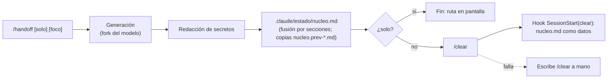

# 11 · Cockpit: handoff y Agent Dock

`kit/mods/cockpit/` es un mod de Claude Code (plugin de *function hooks*, superficie de acceso temprano: puede cambiar entre versiones). Aporta dos cosas y es opt-in: `install.sh` no lo carga.

## Qué hace

- **`/handoff`**: pide al modelo las secciones del estado que cambian, las fusiona en `.claude/estado/nucleo.md` y limpia el contexto (`/clear`); la sesión nueva lo recibe del hook `SessionStart`.
- **Agent Dock**: un panel lateral con una tarjeta por subagente (estado, actividad, tiempo), a dos columnas. También lleva el vigía de contexto con handoff sobre el prompt y `/simple` (modo de pasos con resumen corto).

## Cómo se carga

Este repo es un marketplace (`.claude-plugin/marketplace.json`). Para todas tus sesiones, en scope user, desde el prompt de una sesión de terminal:

```
/plugin install cockpit --marketplace manuelcozar55/setup-claude-code
```

o desde la shell: `claude plugin install cockpit --marketplace manuelcozar55/setup-claude-code` (también lo hace `kit/install-plugins.sh --apply`). Se actualiza con `claude plugin update cockpit@setup-claude-code` y se quita con `claude plugin uninstall cockpit@setup-claude-code`.

Para desarrollarlo desde una copia de trabajo, sin instalar:

```bash
claude --plugin-dir <ruta>/kit/mods/cockpit
```

## `/handoff`

```
/handoff [solo] [foco de la próxima sesión]
```

- Sin argumentos: guarda el documento y hace `/clear`. El mod no envía ningún prompt: el hook `kit/claude/hooks/session-start-clear.sh` (SessionStart `startup|clear`) entrega `nucleo.md` a la sesión nueva como datos, con el protocolo de arranque (`git log --oneline -5`, `git status`, oráculo rápido; si el estado contradice a git, manda git; la «Siguiente acción» solo corre sin preguntar si es de lectura o reversible). Escribe «sigue» para retomar. Así un mensaje tuyo enviado durante el `/clear` no compite con un prompt del mod.
- `solo`: guarda el documento y no limpia nada.
- El resto del texto es el **foco**: el documento se adapta a lo que hará la próxima sesión.
- En la banda sobre el prompt, el botón `handoff` (`h`) pide confirmación con tres acciones: `guardar + /clear` (`y`), `solo guardar` (`g`) y `no guardar + /clear` (`n`: limpia el contexto sin escribir handoff). Las teclas siguen activas aunque no se dibujen. Para cancelar, vuelve a pulsar `handoff`. Durante un turno en marcha solo queda `solo guardar`.

El documento es `.claude/estado/nucleo.md` de la raíz git del cwd (si no es repo, del cwd): la convención de estado que ya leen CLAUDE.md, los hooks PreCompact y la re-inyección tras compactar. El fork devuelve solo las secciones que cambian y el código las fusiona: «Encargo original» e «Invariantes» se conservan byte a byte aunque el modelo las devuelva, y las secciones que el fork no trae se quedan como estaban. Si no existe, el fork extrae además el encargo y los invariantes para crear el esqueleto. La versión anterior se copia a `nucleo.prev-<sello UTC>.md` y se guardan las 3 últimas. Si la respuesta no trae ninguna sección `## `, no se escribe nada. En un repo git, si `.claude/estado/` no está ignorado se añade a `.git/info/exclude`. Antes de escribirlo se redactan claves conocidas (`sk-`, `ghp_`, `AKIA`, `xox*`, JWT) y asignaciones tipo `password=`/`token:` como `[REDACTADO]`. También cubre `Bearer …`, bloques `PRIVATE KEY`, credenciales en URLs (`esquema://usuario:clave@`), `github_pat_`/`glpat-` y valores entrecomillados (incluido JSON). Es una red de seguridad parcial y no garantiza nada: la redacción principal la hace el prompt de handoff, y el filtro solo recoge lo que el modelo deje pasar.

Secciones fijas (las escribe el fork una sola vez): Encargo original (literal) · Invariantes. Secciones que actualiza cada handoff: Plan (`[x]` con el comando que lo verificó / `[ ]`) · Paso actual · Siguiente acción · Pendientes y riesgos · Ficheros tocados (los de fuera de git con su copia de seguridad) · Comandos de verificación · No repetir. No duplica specs, planes, issues ni commits: los referencia por ruta o URL.



## Agent Dock

Se abre solo al iniciar sesión (columna de 66 de ancho) y con `/dock`. Las tarjetas no llevan borde: una barra de color a la izquierda marca el estado y tres líneas fijas dicen todo: `T<n>`, descripción y tiempo; en qué trabaja el agente (`● Bash: make test`, o `○ En cola`, `✓ Hecho`, `✗ Falló`, `◌ Atascado`); y la barra fina con el contador (`5h` o `100%`) en la misma línea. Van a dos columnas desde 50 de ancho útil (a una por debajo). La misión nace plegada en una línea (`▸ texto…`); un clic (o Enter con el foco) la despliega entera (`▾`) y otro la pliega. Los contadores van en una sola línea y abrevian en estrecho (`●2 ○1 ✓3 ×0`). El tamaño de equipo viaja al modelo como contexto oculto del prompt. Los tests miden el texto dibujado a 24, 30, 44, 56 y 66 columnas.

## Tests

```bash
cd kit/mods/cockpit
claude plugin validate .                          # Validation passed
claude plugin test .                              # 30 pass, 0 fail
pnpm dlx --package=typescript@5 tsc -p .          # rc=0
bash ../../test/test_mod_cockpit.sh                # estructura y saneado; sin red ni claude
```

`tsconfig.json` extiende `.claude-plugin/types/tsconfig.json`, que **no se versiona**: lo escribe Claude Code junto al mod cuando lo carga desde una carpeta propia (versión TypeScript 5.4 o superior) y su contenido es de Claude Code, no nuestro. Si falta, `tsc` falla con `Cannot find module 'claude-code/testing'`. Para regenerarlo, carga el mod una vez, por ejemplo `claude -p --plugin-dir "$PWD" "ok"`; si en tu versión no aparece, copia la carpeta `.claude-plugin/types/` de otro mod ya cargado. Está en `.gitignore`. `validate` y `test` no lo necesitan. Sin esos tipos `tsc` pierde el `noEmit` heredado y escribe `.js` junto a las fuentes: bórralos si pasa.

`claude plugin test` funciona desde cualquier carpeta, no solo desde dev-mods.

## Limitaciones conocidas

- **`/clear` lanzado desde el mod no está verificado en una sesión interactiva.** Se comprobó de punta a punta con el arnés de tests, no a mano. Si falla, el mod deja el documento guardado; escribe `/clear` y luego «sigue».
- **Los estados `failed`, `killed` y `stuck` de las tarjetas del dock no se han probado en el render**; solo los estados en curso y completado.
- El redactor de secretos es un último recurso parcial; revisa el documento antes de compartirlo.
- **El documento hereda los permisos del directorio del proyecto**: se crea con los permisos por defecto, no 0600, y sin creación exclusiva (la API `$.fs.write(path, text)` no admite modo). Está en el árbol del proyecto; si git no lo ignora ya, el mod lo añade a `.git/info/exclude` (local, no se versiona).
- El hook de arranque entrega `nucleo.md` envuelto como datos y exige confirmar lo irreversible, pero eso mitiga la inyección de instrucciones escritas en el fichero, no la elimina.
