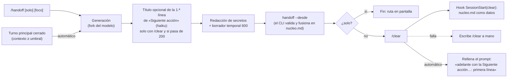

# 11 · Cockpit: handoff y Agent Dock

`kit/mods/cockpit/` es un mod de Claude Code (plugin de *function hooks*, superficie de acceso temprano: puede cambiar entre versiones). Es opt-in: `install.sh` no lo carga. Es una interfaz de terminal y solo actúa en sesiones con persona delante (ver «Sesiones no interactivas»).

## Qué hace

- **`/handoff`**: pide al modelo el borrador de las secciones del estado y se lo entrega al CLI `~/.claude/bin/handoff`, que lo valida y lo fusiona en `.claude/estado/nucleo.md`; después limpia el contexto (`/clear`) y la sesión nueva lo recibe del hook `SessionStart`.
- **Sin cockpit**: `install.sh` no lo instala. El kit guarda solo la sección `## Último turno (auto)` tras cada turno (hook `autosave.sh`, sin modelo) y, además, hace checkpoint + reinyección + aviso: el checkpoint de `pre-compact.sh`, `nucleo.md` reinyectado tras compactar y un aviso al modelo si lleva más de 10 min sin actualizarse (`handoff --desde <borrador>`, con la ruta `~/.claude/bin/handoff` si no está en el `PATH`). `/handoff` es manual y opcional; el cockpit añade la síntesis automática.
- **Handoff automático** (activo por defecto): al cerrar un turno con el contexto al 70 % del límite de autocompactación, el mod guarda el estado con el mismo handoff, hace `/clear` y deja escrito en el prompt «adelante con la Siguiente acción…: <su primera línea>». Una sola vez por cruce del umbral. Se apaga con `COCKPIT_AUTO_HANDOFF=off`.
- **Autosave con modelo** (0.8.0, ADR 028; **apagado por defecto desde 0.9.0**): guarda el estado con el mismo handoff, sin `/clear` ni aviso, por hitos y turnos. Gasta tokens: se enciende con `/autosave on` o `COCKPIT_AUTOSAVE=on`. Detalle en «Autosave con modelo» y «Qué cuesta».
- **`/nueva <tarea>`**: cambia de tarea. Archiva el `nucleo.md` actual, limpia el contexto y deja la tarea nueva en el prompt.
- **`/autonomo on|off`**: continuación automática del trabajo ya autorizado tras un handoff confirmado. Por defecto sigue `COCKPIT_AUTONOMO` (`on` en el `env` de `settings.json` la deja activa en cada proceso nuevo); `/nueva` y un `/clear` manual vuelven a ese valor por defecto.
- **Agent Dock**: un panel lateral con la misión en curso y los subagentes en cuatro secciones fijas (trabajando, en cola, parados, hechos). Muestra también qué sesión escribe el estado y cuánto del tamaño máximo del `nucleo.md` lleva usado. Lleva además el vigía de contexto con handoff sobre el prompt y `/simple` (modo de pasos con resumen corto).

## Cómo se carga

La versión 2.0.0 del kit incluye cockpit 0.9.0.
`scc` carga la copia que `install.sh` deja en `~/.claude/scc/` mediante `--plugin-dir`, sin instalar
nada; las órdenes de marketplace de abajo instalan esa misma versión desde el tag
publicado, para todas tus sesiones. En un paquete transferido, `VERSION` identifica
la publicación, y `BUILD_ID` con el manifiesto SHA-256 identifican el contenido.

**Versión de Claude Code.** Las versiones de referencia de esta entrega son
2.1.311 en Ubuntu y 2.1.317 en Debian (`claude --version`); el paquete conserva
los resultados y las versiones efectivamente verificadas. **Versión mínima: 2.1.311**
(la más antigua probada; los mods son de acceso temprano y pueden cambiar entre versiones). Al arrancar, el mod
pregunta su versión a Claude Code (`$.session.version()`): si es anterior, se apaga (sin dock, comandos ni temporizadores)
y lo dice en un aviso con la orden para actualizar (`claude update`) o quitarlo
(`claude plugin uninstall cockpit@setup-claude-code`). Límite: un Claude Code sin API de mods, o sin
`session.version`, no puede avisar; lo normal es que ignore el módulo, y si el mod carga sin poder comprobar la versión
sigue y lo deja en el log de depuración. Si algo no carga, `claude plugin validate kit/mods/cockpit` dice qué falla.

**El `ref` es una etiqueta, no un sha.** La fuente `github` de un marketplace admite `ref` pero no `sha` (solo las fuentes de cada plugin lo admiten), y una etiqueta de git se puede mover. Protege las etiquetas `v*` en el remoto si quieres un pin real.

**Va con la versión del kit.** El marketplace del kit queda fijado al tag de tu versión (`extraKnownMarketplaces` en `settings.json`), y `install.sh` mueve ese ref en cada actualización. Sin el ref, el cockpit seguía a `main` y podía adelantarse a `~/.claude/bin/handoff`: `/handoff` fallaba con «falta …/bin/handoff». Tras pasar el kit a otra versión (ver «Actualizar» en [`02-install.md`](02-install.md)), repite las dos órdenes de abajo y ejecuta `claude plugin update cockpit@setup-claude-code`.

Este repo es un marketplace (`.claude-plugin/marketplace.json`). Para todas tus sesiones, en scope user, desde la raíz de tu copia del repo:

```bash
claude plugin marketplace add "manuelcozar55/setup-claude-code@v$(cat VERSION)"
claude plugin install cockpit@setup-claude-code
claude plugin update cockpit@setup-claude-code
```

(las dos primeras también las hace `kit/install-plugins.sh --apply`; el `update`, no). Sin el `@v…`, `marketplace add` falla en cuanto `install.sh` ha fijado el marketplace: «its source doesn't match its extraKnownMarketplaces entry». El `update` no sobra: `marketplace add` mueve el ref pero **no actualiza un cockpit ya instalado**, e `install` tampoco lo toca; sin `update` sigues con la versión anterior (medido en Debian el 2026-11-10: 0.6.1 hasta el `update`, 0.8.1 después). Se quita con `claude plugin uninstall cockpit@setup-claude-code`.

**`marketplace add …@tag` desactiva `autoUpdate`.** Reescribe la entrada `setup-claude-code` de `extraKnownMarketplaces` en tu `settings.json` y la deja sin `autoUpdate` (reproducido en Ubuntu y Debian). Si lo tenías activado, vuelve a poner `"autoUpdate": true` en esa entrada después de la orden.

Para desarrollarlo desde una copia de trabajo, sin instalar:

```bash
claude --plugin-dir <ruta>/kit/mods/cockpit
```

## `/handoff`

```
/handoff [solo] [foco de la próxima sesión]
```

- Sin argumentos: guarda el documento y hace `/clear`. El hook `session-start-clear.sh` entrega el estado como datos. En un proyecto añade hechos calculados desde Git; en HOME usa la ranura de este proceso y, si aún no existe, muestra el índice de tareas. Por defecto, el cockpit deja la continuación escrita para revisarla y pulsar Enter. Con `/autonomo on` puede enviarla después de verificar el cambio de sesión y la ausencia de actividad nueva. El estado conserva el encargo; no crea permisos. Con `/clear` hay una segunda llamada al modelo, pequeña y opcional, que pone título a la primera línea de «Siguiente acción» cuando pasa de 200 grafemas (ver «Handoff automático»).
- `solo`: guarda el documento y no limpia nada, y no hace esa llamada de título. No confundir con el CLI: `/handoff solo` es el argumento del mod (guarda sin `/clear`), mientras que `handoff --solo` es una opción del CLI y significa otra cosa: el borrador sustituye al `nucleo.md` entero en vez de fusionarse.
- El resto del texto es el **foco**: el documento se adapta a lo que hará la próxima sesión.
- En la banda sobre el prompt, el botón `handoff` (`h`) pide confirmación con tres acciones: `[guardar + /clear]`, `[solo guardar]` y `[no guardar + /clear]` (limpia el contexto sin escribir handoff), dibujadas sin cromo y sin tecla propia: un clic o Enter bajo el foco. Para cancelar, vuelve a pulsar `handoff`. Durante un turno en marcha solo queda `solo guardar`.

El documento es `.claude/estado/nucleo.md` de la raíz del proyecto, la convención de estado que ya leen CLAUDE.md, los hooks PreCompact y la re-inyección tras compactar. **La raíz es** la raíz git de donde arrancó la sesión (`$.session.root()`, lo que los hooks leen como `CLAUDE_PROJECT_DIR`; un `cd` de la shell no la mueve), salvo que sea `$HOME` o cuelgue de `$HOME/.claude`; sin git tampoco hay proyecto. Sin proyecto, en `$HOME` el estado es el de esta sesión, en `~/.claude/estado/sesiones/<fecha>-<pid>/` (clave: el proceso de Claude; el CLI la resuelve y el mod solo la usa); fuera de `$HOME` y sin git el mod no hace fork ni escribe nada y lo dice.

**Reparto de trabajo.** El fork del modelo solo redacta un borrador con las secciones de la plantilla (`kit/claude/templates/nucleo.md`): Plan, Paso actual, Siguiente acción, Pendientes, Comandos de verificación y Ficheros tocados, y Objetivo e Invariantes cuando faltan o están vacíos. Pide además tres campos baratos: las correcciones literales de la persona (hasta 3 líneas, con fecha, en Invariantes), los ficheros calientes con rango (`ruta:L120-180 — qué`) y el resultado de cada comando de verificación (`→ rc=N`, que el CLI pliega desde `verificaciones.log`). El mod no fusiona nada: no queda en TypeScript ninguna función de fusión, rotación de copias ni exclusión de git; lo hace `handoff` (`test_mod_cockpit.sh` lo comprueba). Con `/clear` hay un segundo paso de modelo, opcional: si la primera línea de «Siguiente acción» del borrador pasa de 200 grafemas, `$.model.complete` con `haiku` (solo esa sección, sin la transcripción) escribe encima un título corto antes de entregar el borrador al CLI. No es contenido de la persona ni del fork: si falla, tarda más de 20 s o devuelve algo que no vale, el borrador sigue como llegó.

**Cómo se entrega.** Antes de escribir se redactan claves conocidas (`sk-`, `ghp_`, `AKIA`, `xox*`, JWT), asignaciones tipo `password=`/`token:`, `Bearer …`, bloques `PRIVATE KEY`, credenciales en URLs, `github_pat_`/`glpat-` y valores entrecomillados: una red de seguridad parcial, porque la redacción principal la hace el prompt. El borrador va a un fichero temporal propio (`mktemp`, permisos 600, borrado siempre al terminar, también si el CLI falla) y el mod ejecuta, con la ruta absoluta (no depende del PATH):

```
$HOME/.claude/bin/handoff --desde <borrador> --raiz <raíz> --sesion <id> --json
```

Si el binario no existe el mod lo dice con la orden de instalación (`bash kit/install.sh --apply` desde el repo setup-claude-code, que copia `handoff` y `oraculo` en `~/.claude/bin`), no llama al modelo y no hay fusión de reserva en TypeScript. Antes de llamar al modelo consulta `handoff --estado`: si otra sesión vigente tiene el estado, no hace fork (sería pagar un borrador que el CLI rechazaría con el código 5).

**El mod solo manda lo que el CLI admite.** El CLI rechaza (código 2) cualquier cabecera fuera de la plantilla (por ejemplo `## Notas`) o repetida. El mod descarta esas secciones del borrador antes de llamar y lo anota en los avisos («omití la sección …»); si no queda ninguna admitida, no escribe nada y lo dice. `kit/mods/cockpit/test_cockpit.sh` ejecuta el CLI real con los borradores del mod y comprueba que la lista de cabeceras del mod es la del CLI.

Con `CLAUDE_HOME` absoluto usa su `bin/handoff`. En HOME omite `--raiz` y usa la ranura del proceso que devuelve `--estado`; nunca inventa una ruta relativa. El recibo JSON debe confirmar ruta absoluta y SHA-256. Trae además `transcript` (ruta del `.jsonl` de la sesión anterior, o `null`) y `bytes` (tamaño de lo escrito); un CLI anterior no los trae y el mod los omite. Un código de salida distinto de 0, un recibo inválido o un dueño ajeno conservan el contexto. Con código 0 y recibo válido, los avisos se muestran y permiten continuar con `/clear`. El código 5 indica dueño ajeno y no se reintenta.

Antes de escribir, el fork recibe un presupuesto en bytes UTF-8: del tope que da `handoff --estado` (6500 B menos los 800 que se reservan para el bloque de agentes de la inyección) se reservan las secciones fijas existentes y 768 B para cabecera, separadores y verificaciones del CLI. Esas Invariantes ya están descontadas: de ellas solo se pide al fork las líneas nuevas de una corrección literal de la persona (el CLI las añade a las que hay y no distingue una línea reformulada de una nueva, así que se le dice que no copie, resuma ni reformule las existentes), y al medir el borrador no cuentan las líneas de Invariantes que el CLI ya tiene (la misma línea, sin espacios en los extremos), que no añaden nada al archivo; el título de la primera línea se mide igual. Se solicita un resumen de hasta 3000 B o el espacio restante si es menor, referenciando la especificación en vez de repetirla. Se mide el borrador redactado con `TextEncoder`; si excede el presupuesto, se pide una sola regeneración que dice cuántos bytes midió y cuántos sobran (un modelo cuenta mal los bytes, y cada vocal acentuada ocupa dos). Si la segunda también se pasa, o no responde, se guarda el más corto de los dos: el CLI es la autoridad de fusión y del tope, omite secciones enteras en su orden (nunca Objetivo, Invariantes ni Siguiente acción; Paso actual se corta por línea), copia lo omitido a diario.md y lo cuenta en sus avisos. Hasta la 1.8.0 ese segundo exceso abortaba sin guardar («el borrador supera el presupuesto… tras dos intentos») y la sesión acababa en la compactación que el handoff evita. Nunca se trunca el objetivo literal para hacerlo caber. Los avisos, el del exceso incluido, se muestran y no impiden el `/clear`.

| Exit | Significado | Qué dice la UI |
|---|---|---|
| 0 | Fusionado | «Guardado en …/nucleo.md» y, salvo `solo`, `/clear` |
| 2 | Borrador inválido | «el CLI rechazó el borrador (borrador inválido: <cabecera que nombra el CLI>); no se guardó nada, repite /handoff» |
| 3 | Sin proyecto | «aquí no hay proyecto …: no hay estado que guardar» |
| 4 | `nucleo.md` cambió durante la fusión | Reintenta una vez con el mismo borrador; si vuelve a fallar, «cambió durante la fusión (dos intentos); repite /handoff» |
| 5 | El estado tiene otro dueño | Conserva el contexto y pide resolver la propiedad; no reintenta |

**Volver a la sesión anterior.** Con `--sesion <id>` (solo `[A-Za-z0-9-]`), el CLI busca `${CLAUDE_CONFIG_DIR:-$HOME/.claude}/projects/*/<id>.jsonl` (primera coincidencia) y escribe bajo el título de `nucleo.md` una sola línea: `> sesión anterior: <ruta> · volver: claude --resume <id> · buscar en él con rg, nunca leerlo entero`. Cada handoff sustituye la anterior, cuenta dentro del tope y no se omite; `session-start-clear.sh` y `session-start-compact.sh` la pasan tal cual, así que la sesión nueva sabe dónde está el transcript sin leerlo. Sin coincidencia o sin `--sesion` no hay línea ni error. En el modo `ESTADO.md` (fichero de la persona, versionado) no se escribe: el recibo sí lleva `transcript` y `bytes`.

**Volver a la misma carpeta.** `/clear` devuelve la sesión al directorio donde arrancó, aunque hubiera hecho `cd` a otro repo. El mod lanza el CLI desde el cwd vivo y con `CLAUDE_PROJECT_DIR` = la raíz de arranque: el estado va a la ranura de `~` (o al proyecto de arranque) y no al repo al que se hizo `cd`, y, si ese cwd difiere del de arranque, `handoff` anota bajo el título `> carpeta de trabajo: <ruta>` (ruta absoluta, de un directorio, ≤ 400 chars; cada handoff la sustituye o la quita; cuenta dentro del tope). Tras `/clear` o `resume`, `session-start-clear.sh` la pasa dentro de los datos y, fuera de ellos, dice a la sesión nueva que se vaya a esa carpeta con `cd` si sigue siendo ahí donde toca trabajar (un paso 5 del protocolo en un proyecto; una frase tras los datos en `~`). Si la carpeta ya no existe, o la ruta no es válida, no se anuncia nada. El mínimo que llega siempre: la ruta del nucleo (`fuente=`), Objetivo y Siguiente acción; si el reparto por tope las deja fuera se copian delante (≤ 600 B cada una, dentro del tope) y, en un nucleo sin secciones de la plantilla, las primeras líneas (≤ 1 500 B) con la ruta de donde está el resto.

**Recibo en el panel.** El toast con el resultado se perdía en el `/clear`. Ahora, con `/clear`, una línea sobre el prompt de la sesión nueva, p. ej. `Handoff: 4321 B guardados · a diario.md: Pendientes, Plan · volver: claude --resume abcdef12-3456-7890-abcd-ef1234567890`, hasta que cierra su primer turno: bytes, secciones que fueron a `diario.md` (de los avisos del CLI) y el id de la sesión cerrada para volver a ella. Con un CLI sin `bytes`/`transcript` sale sin ellos. `/handoff solo` usa el mismo formato en el mensaje de «Guardado». El toast «Contexto al N %: handoff automático…» sigue como estaba.

**`diario.md` sin repetidos.** El CLI no añade a `diario.md` un `[x]` cuyo texto y comando ya estén ahí (sin contar fecha ni hash); el `[x]` sale igualmente de `nucleo.md`. Los demás apuntes (omitidas por tope, archivados) no cambian.

Si la respuesta del fork no trae ninguna sección `## ` no se escribe nada. Si `.claude/estado/`, `nucleo.md` o una copia `nucleo.prev-*` son enlaces simbólicos, el handoff se niega a leer y escribir. Copias, límite de tamaño, `diario.md`, exclusión de `.git/info/exclude` y dueño son del CLI.

Secciones fijas (las fija el CLI: se escriben una sola vez): Objetivo · Invariantes. Secciones que actualiza cada handoff: Plan (`[x]` con el comando que lo verificó, que el CLI mueve a `diario.md` / `[ ]`) · Paso actual · Siguiente acción · Pendientes (incluye riesgos; las líneas que solo puede hacer la persona empiezan por `(persona)` y el índice de `~` las reúne) · Comandos de verificación · Ficheros tocados (los de fuera de git con su copia de seguridad; `handoff --desde` genera arriba un bloque desde git: lo cambiado desde el handoff anterior, marcado con `<!-- git:SHA -->`, más el árbol de trabajo, sin `.claude/estado` (solo nombres de `git status`: un `.env` aparece únicamente si **no** está en `.gitignore`, y entonces es un aviso útil, no una fuga del contenido); debajo se conserva lo escrito a mano). No duplica specs, planes, issues ni commits: los referencia por ruta o URL.



## Handoff automático

Se activa solo, sin comando.

**Disparo.** Al cerrar un turno del bucle principal (`reason` `answer`) con el contexto en o por encima del umbral, un porcentaje del límite de autocompactación. El mod:

1. Guarda el estado con el mismo handoff que `/handoff`.
2. Hace `/clear` desde `$.clock.after`: dentro del hook que el turno espera, el motor lo rechaza.
3. Deja «adelante con la Siguiente acción de .claude/estado/nucleo.md: <primera línea de «Siguiente acción»>» en el prompt, sin enviarlo: así aprobarás sabiendo qué sigue. La línea sale del documento ya fusionado, sin marcador de lista ni caracteres de control. Si pasa de 200 caracteres (grafemas), se corta en el último final de frase que conserve al menos la mitad o, si no hay ninguno, en el último espacio. El corte nunca cae a mitad de palabra, de ruta ni de grafema, y nunca deja abierto un code span (se cuentan como en CommonMark: una racha de n comillas solo la cierra otra de n). Entonces acaba en «… (sigue en <ruta>)», y si «Siguiente acción» tiene más líneas, en «(sigue en <ruta>)». Si lo que queda es menos de la mitad del límite, por ejemplo con una sola palabra larga o con un code span abierto desde el principio, se usa el relleno genérico. Para que ese corte no haga falta, al guardar con `/clear` (el automático y `/handoff` sin `solo`; `/handoff solo` y `/nueva` no construyen relleno y no lo piden): si la primera línea del borrador pasa de 200, un modelo pequeño (`$.model.complete` con `haiku`, que recibe solo esa sección, sin la transcripción) escribe encima un título y la línea larga queda debajo. Se le piden 120 caracteres, pero lo que se le exige es lo que el relleno muestra entero (200): `haiku` apenas atiende al número (19 respuestas reales: de 98 a 182). Si la respuesta no es una sola línea válida (sin `#` ni valla de código al principio, ni code span abierto) o no cabe en el presupuesto, el borrador se guarda tal cual y vale el corte. La llamada es opcional y tiene un techo de 20 s, a propósito: acortarlo descartaría títulos válidos aunque lentos. Mientras dura, el handoff sigue en marcha (un segundo `/handoff` o `/nueva` contestan que hay uno en marcha, y un prompt o texto nuevo hace que el `/clear` automático se omita). Si la llamada falla (error de la API, respuesta vacía, modelo rechazado o techo agotado) o la respuesta no vale, el guardado y el `/clear` siguen sin título y el recibo del panel lo dice en una línea: `aviso: sin título (<motivo>): el relleno corta la primera línea`. Un `aborted` no basta para distinguir una cancelación (Esc sobre el despacho, descarga del mod) de ese techo, así que el límite lo pone el propio mod con un temporizador y una señal suyos: un `aborted` con el techo sin vencer es una cancelación, y el handoff acaba como cuando se cancela el fork (sin llamada al CLI y sin `/clear`, con «cancelado mientras se pedía el título (aborted)»). Límite aceptado: si el borrador del fork omite «Siguiente acción», el CLI conserva la de antes y el relleno no se titula; solo importa si esa primera línea vieja pasa de 200 y no tenía título. El fork recibe la regla, y la plantilla la repite: la primera línea es la acción misma, con su condición, en 160 caracteres como máximo, nunca «pedir el sí». El prefijo fijo impide que el relleno empiece por `/` o `!`. Sin esa línea, o si la relectura del nucleo.md ya guardado falla, el relleno es «sigue con la Siguiente acción de .claude/estado/nucleo.md». La UI cuenta lo que pasó: «revisa el prompt y pulsa Enter», «escribe: <texto>» si el prompt no se pudo rellenar, o «/clear falló: escribe /clear y luego <texto>». Tras lanzar `/clear` el mod comprueba que el id de sesión haya cambiado: si no cambió no dice «Contexto limpio», avisa de que lo escribas tú y deja el prompt relleno igualmente. Si no se pudo lanzar `/clear`, el estado ya está guardado y el mensaje dice qué escribir. Una vez por cruce del umbral: tras guardar, no vuelve a hacerlo hasta que el contexto baje del umbral (compactación o `/clear`) o falle el intento.

Por defecto rellena el prompt (`$.prompt.fill`) y tú pulsas Enter. Con `/autonomo on`, espera a confirmar un identificador de sesión nuevo y envía una sola continuación del objetivo autorizado. La autorización vive en memoria o en `COCKPIT_AUTONOMO` (tu `settings.json`, que el modelo no puede escribir): ningún documento puede activarla. Texto nuevo, otro turno, agentes o shells vivos, SID desconocido o fallo de guardado detienen la limpieza o el envío. Si el resultado de un envío es ambiguo, avisa sin reenviarlo. La misión y sus pasos sobreviven al handoff controlado tanto manual como autónomo.

**Configuración.** Variable `COCKPIT_AUTO_HANDOFF`:

| Valor | Efecto |
|---|---|
| `off` | Desactivado. |
| Entero de 50 a 95 | Umbral en % del límite de autocompactación. |
| Cualquier otra cosa, o vacío | 70. |

Variable `COCKPIT_AUTONOMO`: con `on`, `/autonomo` arranca activado en cada proceso y `/nueva` o un `/clear` manual vuelven a ese valor; cualquier otra cosa, o vacío, es «apagado». Es la autorización permanente de la persona: sin ella cada `claude` nuevo empezaba apagado y tras cada handoff había que pulsar Enter.

**Cuándo no actúa.**

- En un subagente: solo cuenta el bucle principal.
- Con subagentes o teammates sin terminar.
- Con un handoff en curso. Un handoff en error se muestra y vuelve a reposo al siguiente cierre de turno, que ya puede intentarlo otra vez.
- Sin proyecto ni ranura HOME confirmada por el CLI. En HOME la ranura del proceso permite los mismos controles que un proyecto.
- Si empieza otro turno entre el guardado y el `/clear`: no limpia, deja el documento guardado y avisa.

**Sin veto de compactación** (desde 0.7.0, ADR 026). En máquinas con ajustes gestionados el plugin integrado `cc-plugin-sec-default` pasa `session.compact` por encima de los plugins de usuario, así que el veto nunca corría. Si el contexto llega al límite a mitad de turno, compacta y actúa la red de `pre-compact.sh` y `session-start-compact`; el aviso del 70 % pide cerrar la fase y terminar el turno para que el handoff llegue antes. Cada cierre de turno por encima del umbral sin handoff deja su motivo en el log de depuración del runtime.

## Autosave con modelo

Desde 0.8.0 el mod completa la capa 1 del kit (ADR 028, [`12-metodologia.md`](12-metodologia.md)): el hook `autosave.sh` guarda cada turno la sección `## Último turno (auto)` sin modelo y deja `autosave.dirty` si hubo cambios; el cockpit usa ese fichero para decidir cuándo pedirle al modelo una síntesis de las secciones redactadas (Paso actual, Siguiente acción, Pendientes…). Es el mismo handoff que `/handoff solo`, pero **silencioso**: sin toast, sin banda, sin recibo en el chat, sin `/clear` y sin tocar el prompt. Lo único visible es «guardado hh:mm» en el panel. **Desde 0.9.0 está apagado por defecto**: cada síntesis es una llamada al modelo de la sesión con todo su contexto (ver «Qué cuesta»), y quien instala el cockpit no ha pedido ese gasto. La continuidad sin modelo la sigue dando el hook `autosave.sh` del kit. El `/clear` con relleno sigue siendo solo el handoff del 70 %.

**Qué lo dispara** (se evalúa al cerrar un turno del bucle principal, y siempre con `autosave.dirty` presente):

- **Hito:** un `git commit`, `git push` o `gh pr create` por Bash, un TodoWrite con todas las tareas completadas, o un comando de `verificaciones.log` que pasa de rc≠0 a 0. La primera lectura de la sesión fija la referencia y no cuenta.
- **Turnos:** 8 turnos o +15 puntos de contexto desde la última síntesis.
- **Tras compactar:** si `autosave.dirty` trae `motivo=compact`, en el primer cierre de turno con al menos 1 min de margen.
- **Red temporal:** un temporizador de 10 min, solo con `autosave.dirty` y sin síntesis en los últimos 10 min.

**Topes.** Como máximo una síntesis cada 5 turnos y cada 10 min (los hitos esperan a cumplir ambos); ninguna sin `autosave.dirty`; ninguna con otro handoff en curso (un `/handoff` manual durante un autosave contesta que hay uno en marcha). Si no hay respuesta previa del modelo que bifurcar (`nothing-to-fork`) calla y reintenta en el siguiente turno. Un fallo real espera 10 min, luego 20 (retroceso exponencial), y a los 3 fallos seguidos el autosave se para y avisa **una sola vez** con un toast: qué pasó (último motivo) y cómo reactivarlo (`/autosave on`); `/handoff` sigue funcionando. Con otra sesión vigente como dueña del estado no hace fork. Un éxito reinicia la cuenta.

**`/autosave`.** `/autosave on` lo enciende, `off` lo apaga (también el temporizador) y `status` dice si está encendido, la última síntesis (hora y número en la sesión), la marca `dirty`, las reglas, el coste y si el proyecto no tiene aún `.claude/estado/` (`handoff --iniciar`). Vive solo en memoria del mod: por defecto está apagado, `COCKPIT_AUTOSAVE=on` (en el `env` de `settings.json`) lo enciende en cada proceso nuevo, y se reinicia con el proceso. La banda sobre el prompt muestra su estado (fila AUTOSAVE: on, off o parado tras 3 fallos). `on` y `off` solo desde el prompt, como `/autonomo`.

**Medir el coste.** Cada síntesis añade una línea a `~/.claude/session-logs/autosave-cockpit.log` (respeta `CLAUDE_HOME`; se recorta a 2000 líneas) con diez columnas separadas por tabulador: fecha ISO, id de sesión, motivo del disparo, bytes del prompt, bytes del borrador, milisegundos de pared y el `usage` del fork (tokens de entrada, de salida, caché leída y caché escrita, sumados si hubo un reintento). Los intentos fallidos también se anotan, con el motivo terminado en `!fallo`. El fork sí devuelve `usage` (todas las variantes de resultado salvo `nothing-to-fork`); con esas columnas puedes medir cuánto te cuesta en tu cuenta.

## `/nueva`

```
/nueva <la tarea nueva>
```

Cambia de tarea sin arrastrar el contexto. Si hay `nucleo.md`, guarda primero el estado con el handoff, lo mueve a `.claude/estado/archivo/nucleo-<sello UTC>.md`, hace `/clear` y deja la tarea nueva escrita en el prompt. Sin argumento muestra el uso.

- En HOME archiva la ranura propia. Sin estado confirmado no archiva ni limpia.
- El CLI archiva con bloqueo, dueño y hash esperado del último guardado; una escritura concurrente impide el cambio de tarea. `/nueva` desactiva la autonomía.
- No corre con un turno o un handoff en marcha: repítelo cuando termine.
- Si el handoff falla o no puede archivar, no limpia.

## Agent Dock

Se abre solo al iniciar sesión (columna de 66 de ancho) y con `/dock`.

**Misión.** Plegada por defecto en una sola línea, cortada en `…` al ancho del pane, para que los agentes ocupen las filas; la cabecera lleva el porcentaje y el tiempo del turno (`10m42s`). Si no cabe en una línea, la cabecera lleva el botón `▸ más`: un clic o Enter con el foco la despliega entera y `▾ menos` la pliega. Una misión nueva nace plegada. El texto va fuera del botón a propósito: un `Button` no acota a su hijo, así que un `Text` con `wrap` dentro de él no envuelve nunca (por eso el clic de la versión anterior "no hacía nada": desplegaba una sola línea cortada por el borde). Debajo, la barra de progreso (pasos completados; sin pasos muestra «Sin datos de avance». Los agentes hechos se cuentan aparte y no prueban que la misión esté terminada) y, durante el turno, la actividad del agente principal.

**Estado.** Bajo la misión, dos líneas: `estado guardado al N% de su tamaño máximo` (en el color del vigía) y `lo escribe: esta sesión | otra sesión (<id>) | nadie aún` (con «vencido» si el dueño pasó su TTL). Salen de `handoff --estado --raiz <raíz>` (en `$HOME`, `handoff --estado` sin `--raiz`, que da el % del estado propio de la sesión y el mod escribe «esta sesión (estado propio, fuera de un proyecto)» en vez del dueño), la única fuente: el mod no calcula el tope ni el dueño. La lectura nunca la espera el dibujo: se refresca al abrir la sesión, al cerrar un handoff y cada 20 s desde el sondeo de agentes, con un timeout de 5 s; sin proyecto ni ranura, sin binario o con el CLI caído aparece «Continuidad degradada» o «Continuidad no disponible» con la orden para arreglarlo (`kit/doctor.sh`, `bash kit/install.sh --apply`).

**Agentes.** Una columna a cualquier ancho y cuatro secciones fijas con su cuenta, también a cero (atenuadas), en orden de urgencia: `Trabajando`, `En cola`, `Parados` (fallados `✗`, detenidos `■` y atascados `◌`: más de 2 min sin ninguna herramienta en marcha; una llamada larga, como un `make test` de 4 min, es actividad hasta que vuelve) y `Hechos`. Se dibujan todos los agentes de la sesión, sin tope ni `… y N más`: el pane hace scroll. Cada agente es una línea: glifo de estado, `T<n>` por orden de arranque, descripción truncada y tiempo fijo a la derecha. Solo la descripción cede ancho: el prefijo y el tiempo no se encogen nunca, así que el tiempo no se parte en dos líneas por estrecho que sea el pane. El tiempo lleva unidades (`45s`, `10m42s`, `1h05m`) porque un `10:42` a secas se leía como una hora del día. Los que trabajan añaden una segunda línea con su última herramienta (`Bash Ejecutar los tests`, `Read checkout/precio.ts`: de una ruta queda la cola, que es lo que se ve al truncar), y los parados, su motivo (`falló`, `2m10s sin actividad`). Si desaparece del registro sin confirmación, queda «sin confirmar», nunca como completado. Un agente `waiting` (aprobación de un plan o tarea en segundo plano) o `idle` (un teammate entre turnos) sigue en `Trabajando` con ese motivo y no se atasca: no le toca llamar a ninguna herramienta. Si el pane es más bajo que la lista, el motor hace scroll (flechas con el pane enfocado); lo urgente queda arriba. Los botones de `Equipo` van bajo la cabecera, antes de la misión: es el mando que se toca antes de empezar. El tamaño de equipo viaja al modelo como contexto oculto del prompt. Los tests miden el texto dibujado a 24, 30, 44, 56 y 66 columnas, incluidos los estados fallado, detenido y atascado.

**Registro de agentes.** `hooks/agentes.sh` (en `SubagentStart`, `SubagentStop` y `SessionEnd`) apunta cada agente en `.claude/estado/agentes.jsonl`; `SessionStart` inyecta su estado y `handoff --agentes` da la lista entera. Un agente sale «terminado» si entregó mensaje final (`last_assistant_message` del payload o, si falta, el último texto de su transcript) o su `RESULTADO.md`, y «terminado sin informe» solo si no dejó nada: entonces hay que revisar su trabajo antes de darlo por bueno.

## Qué cuesta

| Qué | Cuándo | Llamadas al modelo | Modelo |
|---|---|---|---|
| `/handoff`, `/nueva` | Cuando lo pides | 1 fork de la sesión (todo su contexto en caché); con `/clear` y primera línea de «Siguiente acción» de más de 200 grafemas, 1 llamada extra pequeña | el de la sesión; `haiku` para el título |
| Handoff automático | Una vez por cruce del 70 % del umbral (activo por defecto) | las mismas | las mismas |
| Autosave | Solo si lo activas: por hitos, turnos o red de 10 min, con `autosave.dirty`, con topes de 1 cada 5 turnos y 10 min | 1 fork por síntesis; tras 3 fallos seguidos se para | el de la sesión |
| Vigía, dock, `/simple` | Siempre | 0 | ninguno |

Sin cockpit, el kit guarda el estado sin modelo (`autosave.sh`). El `usage` de cada fork del autosave queda en `~/.claude/session-logs/autosave-cockpit.log`.

## Apagar cada cosa

| Para apagar | Cómo |
|---|---|
| Autosave con modelo | Ya está apagado. Si lo encendiste: `/autosave off` (sesión) o quita `COCKPIT_AUTOSAVE=on` del `env` de `settings.json` |
| Handoff automático | `COCKPIT_AUTO_HANDOFF=off` en el `env` de `settings.json` |
| Continuación automática tras handoff | `/autonomo off`, o quita `COCKPIT_AUTONOMO=on` |
| Dock | se abre solo al iniciar; ciérralo con su botón y `/dock` lo vuelve a abrir |
| Modo simple | `/simple` |
| Todo el cockpit | `claude plugin uninstall cockpit@setup-claude-code` |

## Instalar, actualizar, quitar

Ver «Cómo se carga»: `claude plugin marketplace add "manuelcozar55/setup-claude-code@v$(cat VERSION)"` y `claude plugin install cockpit@setup-claude-code` instalan; `claude plugin update cockpit@setup-claude-code` actualiza (tras cambiar de versión del kit repite el `marketplace add`); `claude plugin uninstall cockpit@setup-claude-code` lo quita. Para ver que está cargado: `claude plugin list`. Los datos del estado (`.claude/estado/`) no los toca el mod al quitarlo.

## Tests

```bash
make test-cockpit    # desde la raíz: tsc en un clon limpio + CLI real + claude plugin validate y test
```

`make test-cockpit` (`kit/mods/cockpit/test_cockpit.sh`, también un job de CI) hace tres cosas:

1. **Tipos**, sobre una copia de lo versionado (como un clon limpio). `tsconfig.json` es autocontenido. Los tipos de la API del mod **no se versionan**: son de Anthropic y los escribe el motor de Claude Code, de la versión instalada, en `.claude-plugin/types/claude-code/index.d.ts` (gitignorado) al cargar el mod desde una carpeta tuya. El script prueba antes `claude plugin validate` y `claude plugin test` sobre el clon (en 2.1.311 ninguno los escribe), luego los que ya haya junto al mod y luego `COCKPIT_TYPES=<ruta>`; sin ninguno, tsc se anuncia SALTADO con el motivo, nunca verde. Para generarlos, abre una sesión interactiva con `claude --plugin-dir kit/mods/cockpit` y ciérrala. Si el tipado falla tras actualizar Claude Code, es la API que cambió: borra `.claude-plugin/types/`, vuelve a cargar el mod para regenerarlos y corrige el código contra ellos. Necesita `tsc` (`COCKPIT_TSC`, `tsc` en el PATH o `pnpm --package=typescript@5.6.3 dlx tsc`); sin él, un SKIP anunciado, y en CI (`COCKPIT_REQUIRE_TSC=1`) un fallo.
2. **Contrato con el CLI real** (`kit/claude/bin/handoff`) en un HOME de usar y tirar: los borradores que pide el mod se aceptan, `## Notas` da código 2, `--estado` trae lo que el mod lee.
3. **`claude plugin validate` y `claude plugin test`** (gratis, no llaman al modelo). Sin `claude` en el PATH, SKIP anunciado, nunca verde.

Por separado: `bash kit/test/test_mod_cockpit.sh` (estructura y saneado; sin red ni claude).

`claude plugin test` funciona desde cualquier carpeta, no solo desde dev-mods.

## Sesiones no interactivas (`claude -p`, SDK)

El cockpit (toasts, `/handoff`, la tecla `h`, el temporizador) es una interfaz de terminal. En `-p` o con el SDK el mod
se carga pero `session.start` trae `isInteractive: false` y se queda quieto: no registra comandos, no abre el dock, no
arma temporizadores y no hace handoff automático ni autosave (ni gasta tokens). Los hooks del kit sí corren. Los hooks del kit distinguen el modo por el entorno que Claude Code les pasa. Medido con un hook de
prueba y `claude -p` de un turno (2.1.308): en `-p` llegan `CLAUDE_CODE_SESSION_ATTENDED=0` y
`CLAUDE_CODE_ENTRYPOINT=sdk-cli` (Claude Code los fija él; un valor heredado no los cambia), y el payload no trae
ningún campo que lo distinga; en una sesión interactiva valen `1` y `cli`. Sin ninguna de las dos variables se asume
persona delante.

En una sesión desatendida:

- El aviso del airbag (`nucleo-nudge.sh`) pide actualizar `nucleo.md`, o `handoff --desde <borrador> --sesion <id>`, y
  seguir. No pide «cierra el turno» (cerrarlo termina la sesión) ni `/handoff`, `/clear` ni la tecla `h`. El Stop no
  emite su `systemMessage`, ni el arranque el de «retomas con la caché caducada».
- La compuerta que denegaba la 4.ª llamada tras el aviso (ADR 020) se retiró: era opt-in y nadie la usaba. Queda la de commit sin nucleo actualizado en el `Stop` (`NUCLEO_GATE=observe|block`).
- El estado inyectado va sin los comentarios `<!-- -->` de la plantilla, y se presenta como datos que se siguen solo si
  encajan con el encargo de esta sesión (interactivo: no se ejecutan hasta que la persona los confirme).
- Con `nucleo.md` sin rellenar se inyecta un aviso corto para rellenarlo.

**Límite: escribir `.claude/estado/` en `-p`.** Con `--permission-mode acceptEdits`, `Write`/`Edit` bajo `.claude/` se
deniegan («sensitive file») y ninguna regla `allow` lo levanta: probado con `Edit(.claude/estado/**)` relativa y
absoluta (`Write(...)` ni se evalúa) y con una redirección por Bash (`printf > .claude/estado/nucleo.md`), que
también se deniega. Funcionan dos caminos: `--permission-mode auto`, o un script invocado por Bash con su `allow`
(`handoff --desde <borrador>`, con el borrador fuera de `.claude/`). El kit no lleva `Bash(handoff *)` en su `allow` por
defecto (`test_settings_template.sh`: handoff envuelve comandos); si lo quieres para una ejecución concreta, pásalo con
`--allowedTools 'Bash(handoff *)'`. Sin ninguno de los dos, el modelo no podrá guardar el estado en `-p`.

**Aviso del airbag en la primera herramienta.** En 2.1.308 el transcript ya trae el `assistant` con `usage` cuando
corre el primer `PostToolUse` (5 pruebas con `Bash` y `Read`, `haiku` y `sonnet`), así que el aviso mide desde la
primera. El caso `ctx=[]` de la prueba de Debian no se reproduce; si ocurre en otra versión, el hook calla en esa
herramienta porque aún no hay uso que medir. Lo que sí se corrigió: la lectura miraba solo las últimas 40 líneas y, con
muchos adjuntos tras el último `assistant`, no lo veía; ahora amplía a 600 si hace falta.

## Limitaciones conocidas

- **Relevo interactivo comprobado en Debian con Claude Code 2.1.306:** `/handoff solo`
  guardó sin limpiar; `/handoff` guardó, ejecutó `/clear` y rellenó la continuación.
  Una compactación manual completó `PreCompact`, y el modelo conservó Objetivo e
  Invariantes sin leer archivos después. Esto no prueba todas las versiones o políticas
  de empresa: un plugin gestionado puede decidir el orden de los interceptores.
- **Sin verificar en una sesión interactiva** (solo con el arnés de tests): el `/clear` lanzado desde el temporizador tras un turno, el relleno del prompt después de él, si `$.command.run('clear')` cambia el id de sesión de forma síncrona (el mod lo comprueba y avisa si no cambió) y el coste real del fork del handoff al 70 % de contexto (ahora medible: el autosave anota el `usage`).
- **Autosave sin verificar en sesión interactiva real:** el fork silencioso desde `turn.complete` y desde el temporizador, su coste en tokens facturados (el log anota el `usage` del fork, pero no hay una medida larga) y el ciclo completo con el `autosave.dirty` que escribe la capa 1 (los tests lo crean a mano con el contrato). `/autosave` no persiste entre sesiones porque el SDK del mod no ofrece almacén.
- **El clic sobre el dock solo llega en pantalla completa**: es donde el terminal reporta clics (y donde existe el dock lateral). Con el pane encajado sobre el prompt, enfócalo (`ctrl+x tab`) y usa Tab + Enter sobre el botón (la única tecla directa es `h`, para el handoff). En terminales estrechos el Dock pasa a ese panel; dale suficiente altura o ciérralo para dejar espacio a la conversación y a las líneas de la barra.
- El redactor de secretos es un último recurso parcial; revisa el documento antes de compartirlo.
- **Permisos del borrador temporal**: la API `$.fs.write(path, text)` no admite modo; el borrador se crea con `mktemp` (600) y se vuelve a fijar con `chmod 600` antes de escribirlo. El permiso del `nucleo.md` final es cosa del CLI.
- El hook de arranque entrega `nucleo.md` envuelto como datos y exige confirmar lo irreversible, pero eso mitiga la inyección de instrucciones escritas en el fichero, no la elimina.
