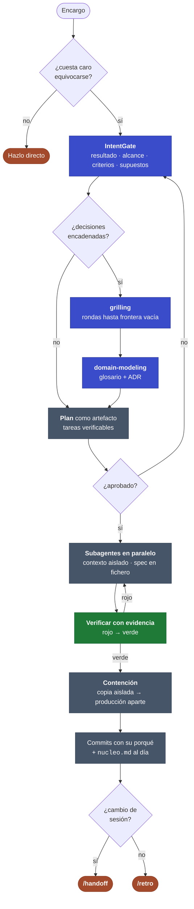

# 12 · Metodología: el método de trabajo, de punta a punta

El kit no solo endurece `~/.claude`: también instala **la forma de trabajar** que hay detrás.
Este documento la cuenta entera y señala qué pieza del kit implementa cada paso. La regla que
lo gobierna es una: **adapta la ceremonia al riesgo**. Un typo, una búsqueda o una pregunta se
hacen directamente; un cambio que cruza módulos, toca seguridad o producción pasa por el bucle.

## 1 · IntentGate: antes de tocar nada

Ante un encargo ambiguo o de varios pasos, una apertura corta fija cuatro cosas:

1. **Resultado**: qué necesita la persona de verdad, no solo lo que pidió literalmente.
2. **Alcance**: qué entra y qué queda fuera.
3. **Criterios verificables**: cómo se sabrá que está hecho. «Que funcione» no es un criterio.
4. **Supuestos**: explícitos. Si hay varias lecturas, se presentan, no se elige una en silencio.

Si hay un camino más simple, se dice. Si algo no está claro, se pregunta **una sola ronda**.
Vive en la plantilla [`kit/claude/CLAUDE.md`](../claude/CLAUDE.md) (sección *IntentGate*), que
`install.sh` deja en tu `~/.claude`.

## 2 · `grilling` y `domain-modeling`: cuando las decisiones cuelgan unas de otras

- **`grilling`** entrevista hasta que no queda nada asumido. Dibuja un **árbol de decisiones**
  y trabaja por **rondas**: la *frontera* es el conjunto de preguntas cuyos prerrequisitos ya
  están resueltos, y se hacen todas juntas, numeradas y con la respuesta recomendada
  redactada para que «sí» la acepte. Las **decisiones** son de la persona; los **hechos**
  (ficheros, herramientas) los busca un subagente, nunca se le piden. Termina cuando la
  frontera está vacía, y no se actúa hasta que la persona confirma el acuerdo.
- **`domain-modeling`** es la disciplina activa de vocabulario: cuestiona un término que choca
  con `GLOSSARY.md`, inventa escenarios límite y escribe el glosario y los **ADR** en el
  momento en que cristalizan (formato en `ADR-FORMAT.md` y `GLOSSARY-FORMAT.md`, dentro de la
  skill). Crea los ficheros solo cuando hay algo que escribir.

## 3 · `deep-change`: el bucle operativo

Se invoca con `/deep-change` o entra solo cuando el cambio es sustancial, ambiguo, irreversible
o toca seguridad o producción. Sus fases:

| Fase | Qué se hace |
|---|---|
| Resolver la incertidumbre | Solo lo que cambia el alcance, el riesgo o el resultado; `grilling` si hay decisiones encadenadas |
| Investigar | Subagentes independientes con dueño explícito; vuelve evidencia, no volcados |
| **Plan como artefacto** | `<tema>-plan.md`: tareas pequeñas y verificables, cada una con ficheros exactos, cambio y prueba. Es un documento duradero, no una conversación |
| Ejecutar | Tarea a tarea; tras cada una, verificar y anotar. No se avanza en rojo |
| Verificar | Reproducir el fallo primero, probar el arreglo después. Evidencia antes de «hecho» |
| **Contener el riesgo** | Construir y validar en una **copia aislada** (carpeta, rama, worktree). Aplicar a producción es un **paso aparte**, con copia de seguridad y rollback conocido |
| Cuentas claras | Beneficio, riesgo y coste de tokens de cada propuesta, y qué se descartó y por qué |

Dos hábitos que el tooling no hace por ti:

- **Registro = commits + `nucleo.md`**: cada commit dice qué y por qué; cada `[x]` del Plan en
  `.claude/estado/nucleo.md` nombra el comando que lo verificó. Sin `*-cambios.md` aparte: quedó
  vacío en dos sesiones seguidas. El hook Stop bloquea una vez si commiteas y nucleo no se movió.
- **Libro de contención**: en todo momento queda dicho qué está hecho en la copia aislada y qué
  está ya en producción. Si ya existe una instrucción explícita de aplicar lo revisado, no se
  vuelve a preguntar.

## 4 · Never-Stop y verificación con evidencia

La puerta de diseño va **antes** de ejecutar. Una vez aprobado el plan rige **Never-Stop**:
se avanza hasta el final sin «¿continúo?». Si surge una ambigüedad a mitad, se toma la opción
conservadora y reversible y se anota en el informe. Lo único que justifica parar es un
bloqueo que no se resuelve sin la persona.

La verificación se hace con evidencia, no con afirmaciones:

- Un test que solo comprueba lo que el código ya hace no prueba nada. Se escribe el que
  **falla primero** (rojo) y pasa con el arreglo (verde).
- Mejor ejecutar el artefacto real que concluir «compila, luego funciona».
- Lo que no se pudo verificar se dice, no se insinúa que pasó.

En este repo el sensor es `make test`, y el hook `Stop` del harness impide cerrar el turno con
el oráculo en rojo (ver [ADR 010](../../knowledge/DECISIONS/010-modo-autonomo.md)).

## 5 · Subagentes en paralelo y estado en disco

- Dos o más flujos independientes se lanzan **en paralelo**, cada uno en su contexto aislado:
  al hilo principal vuelve la conclusión, no el volcado. Secuencial solo ante una dependencia
  real. El kit trae los agentes de [`kit/claude/agents/`](../claude/agents/) (orquestador,
  estratega, implementador autónomo, revisores, explorador y verificador).
- El prompt a un subagente **apunta a un fichero de spec**; no lo pega. Cada uno es dueño de
  sus ficheros, y ninguno hace commit ni push: lo hace el hilo principal.
- El estado de una tarea larga vive **en disco**, en `.claude/estado/nucleo.md`: objetivo,
  invariantes, plan, paso actual, pendientes y comandos de verificación. Se actualiza al abrir
  la tarea, antes de delegar y al cerrar cada fase; tras una compactación se lee antes de
  actuar. Es lo que permite sobrevivir a un contexto que se compacta a mitad de un encargo.

## 6 · Cambiar de sesión y cerrar el ciclo

- **`/handoff`** (mod [`cockpit`](11-cockpit.md)) escribe un documento de traspaso —objetivo,
  invariantes, plan, paso actual, pendientes, comandos de verificación—, limpia el contexto y
  retoma desde él. Con `solo` guarda el documento y no limpia nada.
- **`/retro`** cierra el ciclo: revisa una sesión y propone mejoras al **entorno** del agente
  (punteros de navegación, comprobaciones automáticas, estándares de revisión, tamaño de los
  ficheros de guía, acceso a información), ordenadas por gravedad. Aplicarlas es un cambio
  aparte, por `deep-change`. Es manual: nunca se invoca solo.
- **`to-questionnaire`** convierte una decisión que no puedes resolver solo en un cuestionario
  en Markdown para otra persona. Entrevista solo por el *envío* (a quién, qué necesitas de
  vuelta); las preguntas del documento apuntan a la brecha de conocimiento.

> **No confundir dos `/retro`.** El comando de proyecto
> [`.claude/commands/retro.md`](../../.claude/commands/retro.md) es para trabajar *en este repo*
> (convierte lo aprendido en `knowledge/` versionado); la skill `retro` del kit se instala en el
> `~/.claude` de quien use el kit y analiza el entorno del agente en cualquier proyecto.

## 7 · `writing-for-agents`: cuánto cuesta cada línea

Se usa al crear o editar skills, `AGENTS.md` o `CLAUDE.md`. Su idea central: todo lo que el
agente tiene siempre cargado cuesta tokens y atención **en todos los turnos**, dispare o no.
De ahí tres reglas:

- Un fichero de guía se gasta en **punteros de contexto** (qué es el material y en qué casos
  alcanzarlo), no en el material. Lo que solo necesitan algunas ramas se baja un escalón:
  *divulgación progresiva*.
- Cada paso acaba en un **criterio de finalización** que distinga hecho de no hecho; los
  criterios medibles y exhaustivos son los que fuerzan trabajo a fondo.
- Una línea que el cuerpo ya dice, o un sinónimo que renombra la misma rama, sobra.

Por eso `CLAUDE.md` de este repo tiene un techo de tamaño que vigila
`kit/test/test_harness_structure.sh`, y el mapa va en `AGENTS.md`.

## Qué instala el kit y qué no

| Pieza | Cómo llega a tu entorno |
|---|---|
| Skills `deep-change`, `grilling`, `domain-modeling`, `writing-for-agents`, `retro`, `to-questionnaire` | `install.sh` las copia a `$CLAUDE_HOME/skills/` (diff-first, como los agentes) |
| Agentes | `install.sh` los copia a `$CLAUDE_HOME/agents/` |
| Mod `cockpit` (`/handoff`, Agent Dock) | **No** lo instala `install.sh`: se carga con `--plugin-dir` ([doc 11](11-cockpit.md)) |

Las skills `grilling`, `writing-for-agents`, `domain-modeling`, `retro` y `to-questionnaire`
derivan de [mattpocock/skills](https://github.com/mattpocock/skills) (MIT, con su licencia en
cada carpeta y la atribución en [`THIRD-PARTY.md`](../../THIRD-PARTY.md)). `deep-change` es
propia.
